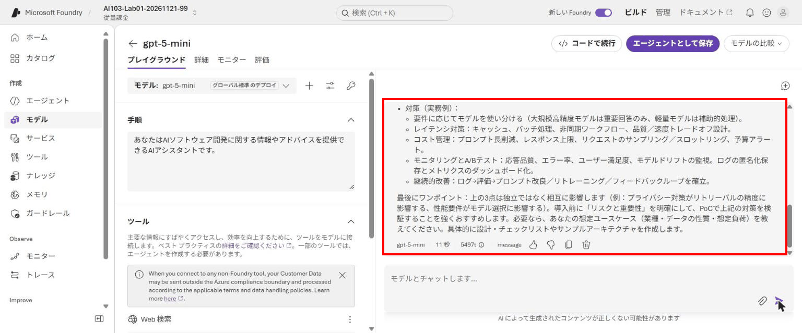

---
lab:
  title: AI 開発プロジェクトの準備
  description: Microsoft Foundry プロジェクトで AI リソースを整理し、Visual Studio Code 用の Foundry Toolkit 拡張機能の使用を開始する方法を学びます。
  level: 200
  duration: 30
  islab: true
  primarytopics:
    - Microsoft Foundry
    - Visual Studio Code
---

# AI 開発プロジェクトの準備

この演習では、Microsoft Foundry ポータルを使用してプロジェクトを作成し、AI ソリューションを構築するための準備を行います。

この演習は約 **30** 分かかります。

> **注**: この演習で使用されるテクノロジの一部は、プレビューの段階または開発中の段階です。 予期しない動作、警告、またはエラーが発生する場合があります。

## 今回のラボ環境をご自身のローカル環境で実現する場合

研修内で配布、使用する環境は以下が含まれています。ローカル環境でラボ内容を実行する場合はインストール等が必要となります。

- 有効な [Azure サブスクリプション](https://azure.microsoft.com/pricing/purchase-options/azure-account)
- [Visual Studio Code](https://code.visualstudio.com/) がインストールされていること
- [Python バージョン**3.13.xx**](https://www.python.org/downloads/release/python-31312/) がインストール済み
- [Git](https://git-scm.com/install/) がインストールおよび構成済み
- [Azure CLI](https://learn.microsoft.com/cli/azure/install-azure-cli?view=azure-cli-latest) がインストールされていること

## Microsoft Foundry プロジェクトを作成する

Microsoft Foundry では "プロジェクト" を使って、AI ソリューションの開発に使われるモデル、リソース、データ、その他の資産を整理します。ここでは Azure Portal から Foundry リソースと最初のプロジェクトを作成します。

> **重要**: ここで作成する Foundry リソースとプロジェクトは、**1〜4 日目のすべての演習で共用します**（2 日目以降は、新しいプロジェクトを作成せず、このプロジェクトを開きます）。リージョンは、3 日目の音声モデルや 4 日目の Azure Content Understanding に合わせて **East US 2** で作成します。リージョンは作成後に変更できません。また、**4 日目の演習 06 の「クリーンアップ」まで削除しないでください**（この日の最後の演習でもリソース グループは削除しません）。

1. Web ブラウザーで **InPrivateウィンドウ（シークレットウィンドウ）** を開き、[Azure Portal](https://portal.azure.com) (`https://portal.azure.com`) にアクセスします。配布された Azure 資格情報でサインインし、多要素認証 (MFA) を求められた場合は画面の指示に従って認証を完了します。

1. Azure Portal 上部の検索ボックスに `Microsoft Foundry` と入力し、**[サービス]** の **[Microsoft Foundry]** を選択します。

    ![Azure Portal の検索結果のスクリーンショット。青枠は検索ボックス、赤枠は [サービス] の [Microsoft Foundry]。](../Media/d1e01-01-search-foundry.png)

1. **[Microsoft Foundry]** の **[概要]** で **[Create a Foundry resource]**（Foundry リソースの作成）を選択して、**[Foundry リソースを作成する]** 画面を開きます。

    ![Microsoft Foundry の概要ページのスクリーンショット。赤枠は [Create a Foundry resource] ボタン。](../Media/d1e01-02-create-foundry-resource-button.png)

1. **[基本情報]** タブで、以下の内容を設定します。

    | 項目                 | 設定内容                                                                 |
    | -------------------- | ------------------------------------------------------------------------ |
    | サブスクリプション   | 従量課金（既定のまま）                                                   |
    | リソース グループ    | 割り当て済みの `AI103StudentXX` を選択（新規作成はしません）             |
    | 名前                 | `AI103-Lab01-YYYYMMDD-XX-resource`（例: `AI103-Lab01-20261006-97-resource`） |
    | リージョン           | (US) East US 2（既定は (US) East US なので、必ず変更します）             |

    ![Foundry リソースを作成する画面の [基本情報] タブのスクリーンショット。青枠は [リソース グループ]、[名前]、[リージョン] の入力欄。](../Media/d1e01-03-foundry-resource-basics.png)

1. 同じ **[基本情報]** タブを下へスクロールし、**[最初のプロジェクト]** の **Default project name** に `AI103-Lab01-YYYYMMDD-XX`（例: `AI103-Lab01-20261006-97`）を入力します（既定で `AI103StudentXX-proj` が入っているので、書き換えます）。**[Agent evaluation and tracing]** の **Application insights** は、既定（新規作成）のままにします。

    ![最初のプロジェクトの Default project name を入力した画面のスクリーンショット。青枠は Default project name の入力欄、赤枠は [確認と作成] ボタン。](../Media/d1e01-04-foundry-resource-project-name.png)

    > **注**: `YYYYMMDD` には実施日、`XX` にはご自身の受講者番号（例: `AI103Student97` の `97`）を使用します。

1. **[確認と作成]** を選択し、検証が終わって **[作成]** が選択できるようになったら、内容を確認して **[作成]** を選択します。

    ![[確認と作成] タブのスクリーンショット。赤枠は設定内容と [作成] ボタン。](../Media/d1e01-05-foundry-resource-review-create.png)

1. デプロイが完了するまで待ちます（2 分ほどかかります）。**「デプロイが完了しました」** と表示されたら、**[リソースに移動]** を選択します。

    ![デプロイの完了画面のスクリーンショット。赤枠は「デプロイが完了しました」と [リソースに移動] ボタン。](../Media/d1e01-06-deployment-complete.png)

    > **注**: Foundry リソースとプロジェクトのほかに、Application Insights と Log Analytics ワークスペースも作成されます。

1. リソースの **[概要]** 画面から **[Foundry ポータルに移動]** を選択して Foundry ポータルを開きます（新しいタブで開きます）。

    ![Foundry リソースの概要画面のスクリーンショット。赤枠は [Foundry ポータルに移動] ボタン。](../Media/d1e01-07-go-to-foundry-portal.png)

    > **ヒント**: 3 日目以降の演習で、Foundry リソース名とプロジェクト名を区別して使います。作成したリソース名（`AI103-Lab01-YYYYMMDD-XX-resource`）とプロジェクト名（`AI103-Lab01-YYYYMMDD-XX`）を控えておいてください。エンドポイントの表記は、後の手順でプロジェクトのホーム ページから確認できます。

    アカウントの選択画面が表示された場合は、配布されたアカウントを選択します。"Operate has now evolved into Manage" などのポップアップが表示された場合は、**[了解]** を選択して閉じると、プロジェクトのホーム ページが表示されます。画面左上に、作成したプロジェクト名（`AI103-Lab01-YYYYMMDD-XX`）が表示されていることを確認します。

## モデルのデプロイとテスト

どの生成 AI プロジェクトの中核にも、少なくとも 1 つの生成 AI モデルがあります。

1. 画面左側のメニューで **[カタログ]** を選択し、**[モデル]** タブを選択して Microsoft Foundry のモデル カタログを表示します。

1. 検索ボックスに `gpt-5-mini` と入力し、検索結果から **gpt-5-mini** のモデル カードを選択します。

    > **注**: 検索結果には、名前の似た多くのモデル（`gpt-5.4-mini` など）が表示されます。**gpt-5-mini** が表示されない場合は、検索結果を下へスクロールして探します。

    ![モデル カタログで gpt-5-mini を検索した画面のスクリーンショット。赤枠は [カタログ]、[モデル] タブ、gpt-5-mini のモデル カード、青枠は検索ボックス。](../Media/d1e01-09-catalog-search-gpt-5-mini.png)

    モデル カードは、モデルの機能と制限事項を理解し、要件に適しているかどうかを判断するのに役立つモデルに関する情報を提供します（gpt-5-mini は、入力の種類が text と image です）。

1. 画面右上の **[デプロイ]** ボタンより **[カスタム設定]** を選択します。

    ![gpt-5-mini のモデル カードのスクリーンショット。赤枠は [デプロイ] ボタンと [カスタム設定]。](../Media/d1e01-10-deploy-custom-settings.png)

1. 以下の内容でモデルをデプロイします。**[1 分あたりのトークン数レート制限]** は既定で大きな値（250,000 など）になっているので、入力欄に `10000` と入力して変更し、**[デプロイ]** を選択します。

    | 項目                            | 設定内容       |
    | ------------------------------- | -------------- |
    | デプロイ名                      | gpt-5-mini（既定のまま） |
    | デプロイの種類                  | グローバル標準 |
    | 1分あたりのトークン数レート制限 | 10,000（10K）  |
    | ガードレール                    | DefaultV2      |

    ![gpt-5-mini のデプロイ画面のスクリーンショット。赤枠は [デプロイ名]、[デプロイの種類]、[ガードレール]、[デプロイ] ボタン、青枠は [1 分あたりのトークン数レート制限] の入力欄。](../Media/d1e01-11-deploy-gpt-5-mini-settings.png)

    > **重要**: この gpt-5-mini のデプロイは、1〜4 日目の演習で共用します（2 日目以降は新しくデプロイせず、このデプロイを使います）。

1. モデル デプロイにより、プロジェクト内のモデルを操作できます。

    モデルがデプロイされると、モデル プレイグラウンドが自動的に開き、モデルをテストできます。

1. **[手順]** ボックスに、次の指示を入力（書き換え）します。

    ```text
    あなたはAIソフトウェア開発に関する情報やアドバイスを提供できるAIアシスタントです。
    ```

1. チャット ウィンドウで「`AIアプリケーション開発において、大規模言語モデルを活用する際の3つの重要な考慮点を説明してください。`」などのクエリを入力して送信し、応答を確認します。

    ![モデル プレイグラウンドのスクリーンショット。青枠は [手順] ボックスとチャットの入力欄、赤枠は送信ボタン。](../Media/d1e01-12-playground-instructions-chat.png)

    


## Foundry Azure のリソースとプロジェクト エンドポイントを表示する

1. Foundry ポータルの上部のメニュー バーで、**[管理]** を選択します。

    プレイグラウンドから移動するときに **[保存せずに終了しますか?]** と表示された場合は、**[保存せずに終了]** を選択します。

    **[Fleet overview]** では、プロジェクトの監視（エージェントの実行数、トークンの使用量、コスト、ポリシー違反など）を確認できます。左側のメニューには、**[リソースの詳細]** と **[プロジェクトの詳細]** があります。

    ![Foundry ポータルの [管理] の Fleet overview のスクリーンショット。赤枠は上部の [管理]、監視情報、[リソースの詳細] と [プロジェクトの詳細]。](../Media/d1e01-14-manage-fleet-overview.png)

    - リソースの詳細は、プロジェクトをサポートするために Azure で作成された **[Foundry]** リソースに関連します。 このリソースは、Foundry のサービスとモデルへの接続を含んでおり、AI 開発プロジェクトへのユーザー アクセスを一元的に管理するための場所となります。
    - プロジェクトの詳細は個々のプロジェクトに関連します。プロジェクトでプロジェクト固有のリソースを追加および管理できます。 1 つのリソースで複数のプロジェクトをサポートできます (最初に作成されるのは、リソースの *既定の* プロジェクトです)。

1. 左側のメニューで **[プロジェクトの詳細]** を選択し、プロジェクトに関連付けられている **[親リソース]** へのリンクを選択します。

    ![[プロジェクトの詳細] のスクリーンショット。赤枠は [プロジェクトの詳細] と [親リソース] のリンク。](../Media/d1e01-15-project-details-parent-resource.png)

    リソース構成の詳細（**[リソースの詳細]**）が表示されるはずです。

    Foundry リソースには "エンドポイント"（`https://<Foundry リソース名>.services.ai.azure.com/`）があり、ここを通じてクライアント アプリケーションが resource レベルの機能 (resource 内のすべてのプロジェクトで共有される Foundry Tools など) にアクセスできます。

    ![[リソースの詳細] のスクリーンショット。赤枠は Foundry リソース名とエンドポイント。](../Media/d1e01-16-resource-details-endpoint.png)

1. 上部のメニュー バーで **[ビルド]** を選択し、左側のメニューで **[ホーム]** を選択して、プロジェクトのホーム ページに戻ります。
1. APIキー、プロジェクト エンドポイント、および Azure OpenAI エンドポイントは書き留めておいてください。

    ![Foundry プロジェクトのホーム ページのスクリーンショット。赤枠はプロジェクト名、[プロジェクト エンドポイント] と [Azure OpenAI エンドポイント]。](../Media/d1e01-08-foundry-project-home.png)

    この情報は、クライアント アプリケーションからプロジェクトレベルのリソースに接続するために使用されます。

    - "APIキー" は、モデルとツールに対するキーベースの認証に使用されます (ただし、ほとんどの運用環境のシナリオでは、認証済みのユーザーとアプリケーションの ID に基づく Microsoft Entra ID 認証の使用を検討する必要があります)。API キーは他の人と共有しないでください。
    - "プロジェクト エンドポイント"（`https://<Foundry リソース名>.services.ai.azure.com/api/projects/<プロジェクト名>`）は、**Responses** API を使用して Foundry で直接提供されるモデル (OpenAI モデルを含む) にアクセスしたり、Foundry 固有の API (Foundry Agent サービスなど) にアクセスしたりするために使用されます。
    - "Azure OpenAI エンドポイント"（`https://<Foundry リソース名>.openai.azure.com/openai/v1`）は、**Chat Completions** API、**Responses** API など、OpenAI の API を使用してモデルにアクセスするために使用されます。

    > **注**: エンドポイントのホスト名の部分は、Foundry リソース名がすべて小文字で表示されます（例: `ai103-lab01-20261006-97-resource`）。

## Visual Studio Code 用の Foundry Toolkit 拡張機能をインストールする

開発者は、Foundry ポータルである程度の時間作業しますが、Visual Studio Code でも多くの時間を費やす可能性があります。 Foundry Toolkit 拡張機能は、開発環境を離れることなく Foundry プロジェクト リソースを操作するための便利な方法を提供します。

1. 演習用仮想マシンでVisual Studio Code を起動します。

1. 左側のナビゲーション バーで、**[拡張機能]** （ブロック状のアイコン）を表示します。

1. 拡張機能のマーケットプレースで `Foundry Toolkit` を検索し、**[Foundry Toolkit for VS Code]** 拡張機能をインストールします。

    拡張機能のインストールには 1 分ほどかかる場合があります。

1. 拡張機能をインストールした後、左側のナビゲーション バーで **[AI Toolkit]** （パズルピース状のアイコン）を選び、読み込まれるまで待ちます。

    [AI Toolkit] ペインの **[MODEL TOOLS]** セクションで、**[Model Playground]** を選択します。 次に、**[gpt-5-mini]** モデルを選択します (まだ選択されていない場合)。

    モデルをテストできる対話型のプレイグラウンドが Visual Studio Code で開きます。
    
    > 注：実際のテストは本ラボフェーズでは実施しません。テストを実行しようとするとGitHubを介した認証が求められます。実際の運用ではこれらのツールを使用してモデルのテストとアプリの開発をVisual Studio Code上で効率良く進めることが可能です。


## まとめ

この演習では、Microsoft Foundry を作成し、Foundry ポータルで詳しく調べました。 また、Visual Studio Code の Foundry Toolkit 拡張機能についても調べました。これは、開発者が Foundry プロジェクトとそのアセットを操作するための便利な方法を提供します。
