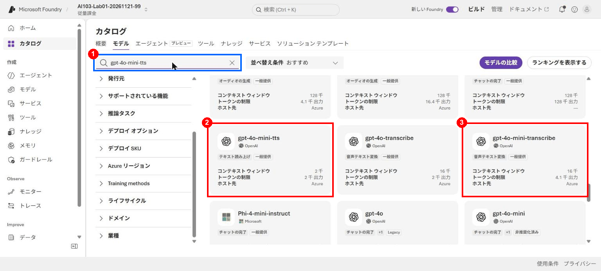

---
lab:
    title: '音声対応の生成 AI モデルの使用'
    description: '生成 AI を使用して音声機能を実装する。'
    level: 300
    duration: 35
    islab: true
    status: 'released'
---

# 音声対応の生成 AI モデルの使用

生成 AI モデルの機能は、テキストベースの言語補完だけでなく、音声を含むその他の形式のコンテンツにも対応するように進化しています。

この演習では、生成 AI モデルを使用して、次の 2 つの一般的なシナリオを実装します。

- 音声合成（テキスト読み上げ）: 音声出力を生成する。
- 音声認識（音声テキスト変換）: 音声入力を文字起こしする。

この演習の所要時間は約 **35** 分です。

> **注意**: この演習で使用する一部のテクノロジーはプレビュー中または開発中のため、予期しない動作、警告、またはエラーが発生する場合があります。

## 前提条件

この演習を開始する前に、以下を準備してください。

- 1 日目の演習 01 の完了（1 日目で作成した Foundry プロジェクトを共用します）
- Visual Studio Code、Python 3.13 以降、Azure CLI（演習環境にはインストール済みです）

## 共用の Foundry プロジェクトの確認

この演習で使用するモデルは **East US 2** で提供されるバージョンとデプロイの種類に基づいています。1 日目の演習 01 で **East US 2** に作成したプロジェクトをそのまま使用します。

1. Web ブラウザーで [Microsoft Foundry ポータル](https://ai.azure.com)（`https://ai.azure.com`）を開き、1 日目の演習 01 で作成したプロジェクト（例: **AI103-Lab01-YYYYMMDD-XX**）を開きます。

    > **重要**: [モデルの提供状況](https://learn.microsoft.com/azure/foundry/foundry-models/concepts/models-sold-directly-by-azure-region-availability) は、リソースのリージョン、モデルのバージョン、デプロイの種類によって異なります。この演習では **East US 2** で `gpt-4o-mini-tts` と `gpt-4o-mini-transcribe` を使用します。デプロイできるかどうかは、サブスクリプションのクォータと利用可能な容量にも左右されます。

## モデルのデプロイ

### 音声生成モデルのデプロイ

1. 左側のナビゲーション ペインで **[カタログ]**（Discover）を選択し、**[モデル]**（Models）タブを選択します。Microsoft Foundry のモデル カタログが表示されます。

1. モデル カタログで `gpt-4o-mini-tts` を検索します。

    > **ヒント**: 検索結果には名前の似た多くのモデルが表示されます。`gpt-4o-mini-tts` と `gpt-4o-mini-transcribe` のカードが下のほうに表示される場合は、スクロールして探します。

    

1. モデル カードを確認し、**[デプロイ]**（Deploy）> **[カスタム設定]**（Custom settings）を選択します。**[デプロイの種類]** が **グローバル標準** であることを確認し、**[1 分あたりのトークン数レート制限]**（Tokens per Minute Rate Limit）を **5K**（5000）に設定して（既定値は 100,000）、**[デプロイ]** を選択します。デプロイが終わると、そのモデルのプレイグラウンドが開きます。

    ![gpt-4o-mini-tts のデプロイ パネルのスクリーンショット。赤枠は [デプロイの種類] と [デプロイ] ボタン、青枠は [1 分あたりのトークン数レート制限]。](../Media/d3e03-02-deploy-gpt-4o-mini-tts.png)

1. **[詳細]**（Details）タブを選択して、デプロイの詳細を表示します。モデルの使用に必要な **エンドポイント**（Endpoint）がここに表示されます（あとで必要になります）。

    ![gpt-4o-mini-tts の [詳細] タブのスクリーンショット。赤枠は [詳細] タブ、[エンドポイント]、デプロイ名。](../Media/d3e03-03-tts-details-endpoint.png)

### 音声認識モデルのデプロイ

1. 左側のナビゲーション ペインで **[モデル]**（Models）を選択し、**[デプロイ]**（Deployments）タブを表示します。先ほどデプロイした音声合成モデルが一覧に表示されていることを確認します。

    > **注意**: 一覧には、1 日目にデプロイした `gpt-5-mini`・`gpt-5` や、2 日目の演習 03 で自動でデプロイされた `text-embedding-3-small` なども表示されます。

1. **[デプロイ]**（Deploy）> **[基本モデルをデプロイする]**（Deploy a base model）を選択し、カタログで `gpt-4o-mini-transcribe` を検索します。

1. **[デプロイ]** > **[カスタム設定]** を選択し、**[デプロイの種類]** が **グローバル標準** であることを確認して、**[1 分あたりのトークン数の制限 (TPM)]** を **5K**（5000）に設定し、**[デプロイ]** を選択します。

1. **[モデル]** ページの **[デプロイ]** タブに戻り、デプロイした 2 つのモデルがどちらも一覧に表示されていることを確認します。

    ![[モデル] の [デプロイ] タブのスクリーンショット。赤枠は左側の [モデル] と、gpt-4o-mini-tts・gpt-4o-mini-transcribe のデプロイ。](../Media/d3e03-04-speech-deployments-list.png)

1. 各モデルを選択し、**[詳細]** タブで、コードで使用する **エンドポイント** と **デプロイ名**（[名前]）を確認します。

    > **重要**: [詳細] タブの **エンドポイント** には、`https://<Foundry リソース名>.openai.azure.com/openai/deployments/<デプロイ名>/audio/speech?api-version=...` のような完全な URL が表示されます。コードで使用するのは、先頭の `https://<Foundry リソース名>.openai.azure.com/` の部分だけです。

## スターター コードを開く

アプリケーションの初期ファイルは、演習環境に配置済みです。

1. Visual Studio Code を開きます。

1. **[ファイル] > [フォルダーを開く]** を選択し、配置済みの `Labfiles/03-gen-ai-speech` フォルダーを開きます。

## 音声生成アプリの作成

1. エクスプローラー ペインで **Python/generate-speech** フォルダーを展開します。アプリケーション ファイルは次のとおりです。
    - **.env**（アプリケーションの構成ファイル）
    - **requirements.txt**（インストールが必要な Python パッケージの依存関係）
    - **generate-speech.py**（アプリケーションのコード ファイル）

### アプリケーションの構成

1. **generate-speech** フォルダーを右クリックし、**[統合ターミナルで開く]** を選択します。ターミナルが **generate-speech** フォルダーで開いていることを確認します。

1. ターミナルで次のコマンドを入力して、演習用にあらかじめ構築済みの仮想環境 (`labenv`) を有効化します。

    ```
    .\labenv\Scripts\Activate.ps1
    ```

    > **注意**: 必要な Python パッケージ (OpenAI SDK など) は `labenv` に事前インストール済みです。`pip install` を再実行する必要はありません。

1. **.env** ファイルを開き、`your_endpoint` を **gpt-4o-mini-tts** モデルの **エンドポイント** に置き換えます。`MODEL_NAME` がモデルのデプロイ名になっていることを確認します。

    > **ヒント**: **エンドポイント** は、Foundry ポータルのモデル デプロイの [詳細] タブからコピーし、`.openai.azure.com/` より後ろ（`openai/deployments/...` 以降）を削除します。ここで使用する `AzureOpenAI` クライアントには、`https://<Foundry リソース名>.openai.azure.com/` のような Azure OpenAI リソースのエンドポイントを指定します。`/api/projects/<プロジェクト名>` で終わる Foundry プロジェクトの URL や、末尾に `/openai/v1/` が付いた URL は使用しないでください。デプロイ名はモデル名と異なる場合があるため、デプロイ名を使用します。

    変更後、**Ctrl+S** キーを押して構成ファイルを保存します。

### 音声生成にモデルを使用するコードの記述

1. **generate-speech.py** ファイルを開き、既存のコードを確認します。OpenAI SDK を使用してモデルにアクセスするコードを追加していきます。

1. ファイルの先頭の既存の参照の下にあるコメント **名前空間のインポート** を見つけて、OpenAI SDK を使用するために必要な名前空間をインポートする以下のコードを追加します。

    ```python
    # 名前空間のインポート
    from openai import AzureOpenAI
    from azure.identity import DefaultAzureCredential, get_bearer_token_provider
    ```

1. **main** 関数では、構成ファイルからエンドポイントを読み込むコードがすでに用意されています。コメント **Azure OpenAI クライアントを作成** を見つけて、OpenAI API のクライアントを作成する以下のコードを追加します。

    ```python
    # Azure OpenAI クライアントを作成
    token_provider = get_bearer_token_provider(
        DefaultAzureCredential(), "https://ai.azure.com/.default"
    )

    client = AzureOpenAI(
        azure_endpoint=endpoint,
        azure_ad_token_provider=token_provider,
        api_version="2025-03-01-preview"
    )
    ```

    API キーではなく、Microsoft Entra ID のトークン（`az login` の資格情報）で認証していることに注目してください。

1. コメント **音声を生成してファイルに保存** を見つけて、音声生成モデルにプロンプトを送信し、応答をファイルとして保存する以下のコードを追加します。

    ```python
    # 音声を生成してファイルに保存
    with client.audio.speech.with_streaming_response.create(
        model=model_deployment,
        voice="alloy",
        input="私の声がパスポートです!",
        instructions="真剣なトーンで話してください。",
    ) as response:
        response.stream_to_file(speech_file_path)
    ```

    `input` は読み上げるテキスト、`instructions` は話し方の指示で、どちらも日本語で指定できます。モデルは `input` のテキストの言語で話すため、言語を指定するパラメーターはありません。英語で試す場合は、どちらも英語の文に置き換えます。

1. コード ファイルに加えた変更を保存します。

### アプリケーションの実行

1. ターミナル ペインで、次のコマンドを使用して Azure にサインインします。

    ```
    az login
    ```

1. メッセージに従って Azure にサインインします。

1. サインインしたら、次のコマンドを入力してアプリケーションを実行します。

    ```
    python generate-speech.py
    ```

1. 出力を確認します。コードは要求された音声を生成してファイルに保存します。コードは生成された音声ファイルも再生します。日本語の音声が再生されることを確認します。

    > **ヒント**: `voice="alloy"` でも日本語を発音できます。地名などの読みが不自然な場合は、`voice` を `coral`、`nova`、`shimmer`、`sage` などに変えて試します。「吾輩（わがはい）」のような古い読みは、どの声でも読み違えることがあります。

    > **ヒント**: スピーカーが使えない環境では、音声の再生でエラーが表示されることがあります。その場合も、**generate-speech** フォルダーに `speech.mp3` が作成されていること、そしてそのファイルサイズが 0 より大きいことを確認すれば、音声が生成されたことを確認できます。VS Code のエクスプローラーでファイルを選択すると、再生用のプレーヤーが表示されます。

## 音声文字起こしアプリの作成

1. エクスプローラー ペインで **Python/transcribe-speech** フォルダーを展開します。アプリケーション ファイルは次のとおりです。
    - **.env**（アプリケーションの構成ファイル）
    - **requirements.txt**（インストールが必要な Python パッケージの依存関係）
    - **speech_ja.wav**（文字起こしする日本語の音声ファイル）
    - **speech.wav**（英語の音声ファイル。英語でも試せます）
    - **transcribe-speech.py**（アプリケーションのコード ファイル）

### アプリケーションの構成

1. **transcribe-speech** フォルダーを右クリックし、**[統合ターミナルで開く]** を選択します（または既存のターミナルで **Python/transcribe-speech** フォルダーに移動します）。ターミナルが **transcribe-speech** フォルダーで開いていることを確認します。

1. 次のコマンドを入力して、このフォルダー用にあらかじめ構築済みの仮想環境 (`labenv`) を有効化します。

    ```
    .\labenv\Scripts\Activate.ps1
    ```

    > **注意**: 必要な Python パッケージは `labenv` に事前インストール済みです。`pip install` を再実行する必要はありません。

1. **.env** ファイルを開き、`your_endpoint` を **gpt-4o-mini-transcribe** モデルの **エンドポイント** に置き換えます。`MODEL_NAME` がモデルのデプロイ名になっていることを確認します。

    > **ヒント**: 音声生成アプリと同様に、Foundry プロジェクトの URL ではなく、Azure OpenAI リソースのエンドポイントとデプロイ名を使用します。

    変更後、**Ctrl+S** キーを押して構成ファイルを保存します。

### 音声文字起こしにモデルを使用するコードの記述

1. **transcribe-speech.py** ファイルを開き、既存のコードを確認します。OpenAI SDK を使用してモデルにアクセスするコードを追加していきます。

1. ファイルの先頭の既存の参照の下にあるコメント **名前空間のインポート** を見つけて、OpenAI SDK を使用するために必要な名前空間をインポートする以下のコードを追加します。

    ```python
    # 名前空間のインポート
    from openai import AzureOpenAI
    from azure.identity import DefaultAzureCredential, get_bearer_token_provider
    ```

1. **main** 関数では、構成ファイルからエンドポイントを読み込むコードがすでに用意されています。コメント **Azure OpenAI クライアントを作成** を見つけて、OpenAI API のクライアントを作成する以下のコードを追加します。

    ```python
    # Azure OpenAI クライアントを作成
    token_provider = get_bearer_token_provider(
        DefaultAzureCredential(), "https://ai.azure.com/.default"
    )

    client = AzureOpenAI(
        azure_endpoint=endpoint,
        azure_ad_token_provider=token_provider,
        api_version="2025-03-01-preview"
    )
    ```

1. コメント **モデルを呼び出して音声ファイルを文字起こし** を見つけて、音声ファイルを音声認識モデルに送信して文字起こしを生成する以下のコードを追加します。

    ```python
    # モデルを呼び出して音声ファイルを文字起こし
    audio_file = open(file_path, "rb")
    transcription = client.audio.transcriptions.create(
        model=model_deployment,
        file=audio_file,
        response_format="text"
    )

    print(transcription)
    ```

1. コード ファイルに加えた変更を保存します。

### アプリケーションの実行

1. ターミナル ペインで、サインインの有効期限が切れている場合は、次のコマンドでもう一度 Azure にサインインします。

    ```
    az login
    ```

1. サインインしたら、次のコマンドを入力してアプリケーションを実行します。

    ```
    python transcribe-speech.py
    ```

1. 出力を確認します。コードは音声ファイルを文字起こし用にモデルへ送信し、結果を表示します。コードは音声ファイルも再生します。

    **出力例**:

    ```output
    画面の向こう側では、すべてがとても簡単そうに見えます。
    ```

    このアプリは、**speech_ja.wav**（日本語の音声）を文字起こしします。ファイルは **transcribe-speech.py** の `file_path` の行で指定しています。英語の音声ファイル **speech.wav** を文字起こしする場合は、`file_path` の行の `speech_ja.wav` を `speech.wav` に変更して、もう一度実行します（出力例: `Oh man, on the other side of the screen, it all looks so easy.`）。

    > **ヒント**: 文字起こしモデルは音声の言語を自動で判定するため、日本語の音声でも言語を指定する必要はありません。言語が分かっている場合は、`client.audio.transcriptions.create` の呼び出しに `language="ja"` のような引数を追加して指定することもできます。

    > **ヒント**: このアプリは、文字起こしの **前** に `speech_ja.wav` を再生します。スピーカーが使えない環境では、この再生でエラーが表示され、以降の処理（文字起こし）が実行されないことがあります。その場合は、コメント **音声ファイルを再生** の下にある `playsound(file_path)` の行の先頭に `#` を付けてコメントアウトしてから、もう一度実行してください。文字起こしの結果が表示されれば、音声認識は成功しています。

## クリーンアップ

この演習でデプロイした **モデル（gpt-4o-mini-tts と gpt-4o-mini-transcribe）と Foundry プロジェクトは、まだ削除しないでください。** リソースの削除は、**4 日目の演習 06「ナレッジ マイニング ソリューションの作成」の「クリーンアップ」**で、1〜4 日目の分をまとめて行います。
