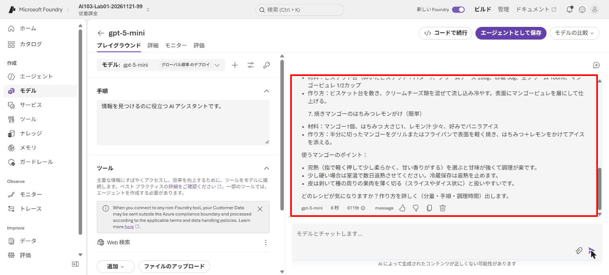
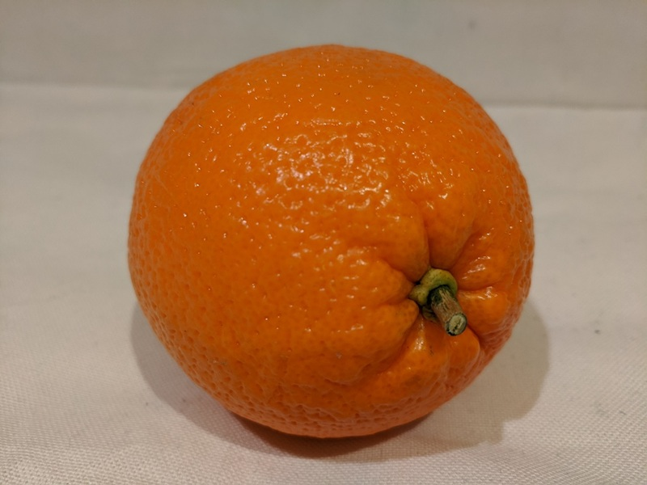
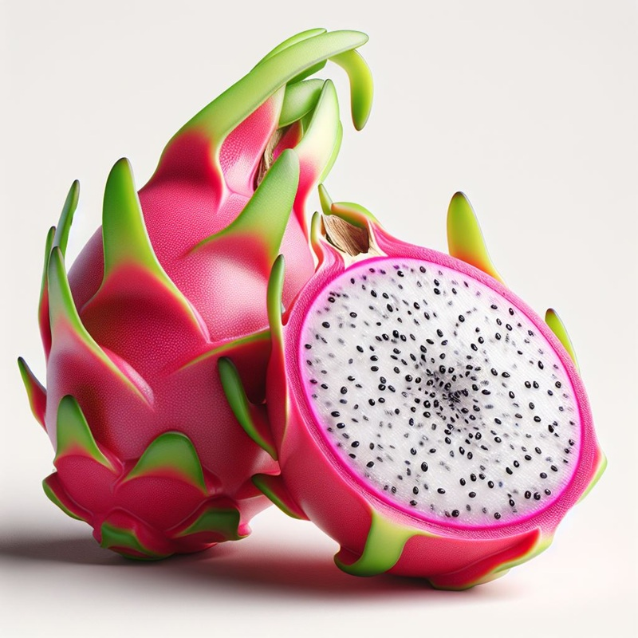

---
lab:
    title: 'ビジョン対応チャット アプリの開発'
    description: 'Microsoft Foundry を使用して、画像入力をサポートする生成 AI アプリを構築する。'
    level: 300
    duration: 45
    islab: true
    status: 'released'
---

# ビジョン対応チャット アプリの開発

この演習では、生成 AI モデルを使用して、画像を含むプロンプトへの応答を生成します。Microsoft Foundry と OpenAI SDK を使用して、食料品店の生鮮食品に関する AI アシスタント機能を提供するアプリを開発します。

この演習の所要時間は約 **45** 分です。

> **注意**: この演習で使用する一部のテクノロジーはプレビュー中または開発中のため、予期しない動作、警告、またはエラーが発生する場合があります。

## 前提条件

この演習を開始する前に、以下を準備してください。

- アクティブな [Azure サブスクリプション](https://azure.microsoft.com/free/)
- 1 日目の演習 01 の完了（1 日目で作成した Foundry プロジェクトを共用します）
- Visual Studio Code、Python 3.13 以降、Azure CLI（演習環境にはインストール済みです。詳細は [演習環境 構築ガイド（共通）](00-environment-setup.md) を参照してください）

## 共用の Foundry プロジェクトを開く

Microsoft Foundry では、プロジェクトを使用して、AI ソリューションの開発に使用するモデル、リソース、データ、その他の資産を整理します。

> **重要**: この演習では、新しいプロジェクトは作成しません。**1 日目の演習 01** で作成した Foundry プロジェクト（**East US 2**）を、1〜4 日目のすべての演習で共用します。この演習でこのプロジェクトにデプロイするモデルは、**この後の演習 02〜05 でも使用します**。**4 日目の演習 06 の「クリーンアップ」まで削除しないでください。**

1. Web ブラウザーで [Microsoft Foundry ポータル](https://ai.azure.com)（`https://ai.azure.com`）を開き、Azure の資格情報でサインインします。初回サインイン時に表示されるヒントやクイック スタートのペインは閉じます。

    > **注意**: 初回サインイン時に、既定の名前（`{アカウント名}-XXXX`）のプロジェクトとエージェント **my-first-agent** が自動作成されることがあります。このプロジェクトは **East US 2 以外**（West US 3 など）に作成される場合があるため、使用しません。

1. ページ上部のツール バーで **[新しい Foundry]**（New Foundry）トグルがオフの場合は、オンにします。ページ左上のプロジェクト名の横にある **⌄** を選択し、1 日目の演習 01 で作成したプロジェクト（例: **AI103-Lab01-YYYYMMDD-XX**）を選択します。

    > **注意**: 4 日目の演習 03〜05 で使用する Azure Content Understanding は、特定のリージョンでのみ利用できます。このプロジェクトは **East US 2** にある必要があります。プロジェクトが **East US 2** にない場合や、1 日目のプロジェクトが見つからない場合は、講師に確認してください。

1. プロジェクトのホーム ページに、**[API キー]**、**[プロジェクト エンドポイント]**、**[Azure OpenAI エンドポイント]** が表示されていることを確認します。

    > **ヒント**: このあとの手順で **Azure OpenAI エンドポイント** が必要になります。Foundry リソース名とプロジェクト名は別の名前です。リソース名は、**[プロジェクト エンドポイント]**（`https://<Foundry リソース名>.services.ai.azure.com/api/projects/<プロジェクト名>`）のホスト名の先頭部分です。プロジェクト名から推測せず、必ずエンドポイントに表示された名前を、そのまま使用してください。

## モデルの確認

画像ベースの入力を処理できるモデルが必要です。この研修では、**1 日目の演習 01 でデプロイした gpt-5-mini**（デプロイ名 `gpt-5-mini`、グローバル標準、TPM 10K）を使用します。gpt-5-mini は画像の入力に対応しているため、新しいモデルをデプロイする必要はありません。

1. 左側のナビゲーション ペインで **[モデル]** を選択し、**gpt-5-mini** の **[デプロイの状態]** が **Succeeded** であることを確認します。

1. **gpt-5-mini** を選択して、モデルのプレイグラウンド ページを開きます。このページでモデルとチャットできます。

    > **ヒント**: モデルの **デプロイ名**（`gpt-5-mini`）を控えておいてください。あとで必要になります。

    > **注意**: 共用のプロジェクトは 1〜4 日目で使うため、別のリージョンに新しいプロジェクトを作成しないでください（3 日目・4 日目の演習が実施できなくなります）。

## プレイグラウンドでのモデルのテスト

1. エクスプローラーまたはファイル マネージャーで、`Labfiles/01-gen-ai-vision` フォルダーにある **mango.jpeg** の場所を確認します。

1. Foundry ポータルで、モデルのデプロイのチャット プレイグラウンド ページに戻ります。

1. メインのチャット セッション パネルで、チャット入力ボックスの下にある添付ボタン（**&#128206;**）を使用して *mango.jpeg* 画像ファイルをアップロードします。次に、`この果物を使って、どんなデザートが作れますか?` というテキストを追加して、プロンプトを送信します。

    ![gpt-5-mini のチャット プレイグラウンドのスクリーンショット。赤枠は [モデル] の gpt-5-mini、添付ボタン、送信ボタン、青枠はプロンプトと添付した mango.jpeg。](../Media/d4e01-01-playground-image-attach.png)

1. 応答を確認します。マンゴーを使って作れるデザートに関する適切な案が返されるはずです。

    

## クライアント アプリケーションの作成

### スターター コードを開く

アプリケーションの初期ファイルは、演習環境に配置済みです。

1. Visual Studio Code を開きます。

1. **[ファイル] > [フォルダーを開く]** を選択し、配置済みの `Labfiles/01-gen-ai-vision` フォルダーを開きます。

1. VS Code のエクスプローラー ペインで **Python** フォルダーを展開し、フォルダー内のファイルを確認します。

    * `.env` - アプリケーション設定の構成ファイル
    * `image-chat-app.py` - 画像アプリケーションの Python コード ファイル
    * `requirements.txt` - パッケージの依存関係を一覧にしたファイル
    * `mystery-fruit.jpeg` - 果物の画像

### アプリケーションの構成の準備

1. **Python** フォルダーを右クリックし、**[統合ターミナルで開く]** を選択します。ターミナルが **Python** フォルダーで開いていることを確認します。

1. ターミナルで次のコマンドを入力して、仮想環境を作成し、必要な Python パッケージをインストールします。

    ```
    python -m venv labenv
    .\labenv\Scripts\Activate.ps1
    pip install -r requirements.txt
    ```

    > **注意**: スクリプトの実行がブロックされて `Activate.ps1` が実行できない場合は、`Set-ExecutionPolicy -Scope Process Bypass` を実行してから、もう一度有効化してください。プロンプトの先頭に **(labenv)** と表示されれば、仮想環境が有効です。

1. **.env** ファイルを開き、構成値を更新します。Foundry リソースの **Azure OpenAI エンドポイント** と、生成 AI モデルの **デプロイ名** を設定します。

    > **重要**: `.env` の `MODEL_DEPLOYMENT` には `gpt-5.2` が設定されています。この研修では、`gpt-5-mini` に書き換えてください。

    > **重要**: 必ず `https://{Foundry リソース名}.openai.azure.com/openai/v1` の形式の Azure OpenAI エンドポイントを指定してください。プロジェクト エンドポイントでは <u>ありません</u>。

    変更後、**Ctrl+S** キーを押して構成ファイルを保存します。

### OpenAI チャット クライアントを取得するコードの記述

> **ヒント**: コードを追加するときは、正しいインデントを維持してください。

1. VS Code で `image-chat-app.py` ファイルを開きます。

1. コード ファイルの先頭に、必要な SDK の名前空間をインポートする既存のステートメントがあります。次に、コメント **参照の追加** を見つけて、前にインストールしたライブラリの名前空間を参照する以下のコードを追加します。

    ```python
    # 参照の追加
    from openai import OpenAI
    from azure.identity import DefaultAzureCredential, get_bearer_token_provider
    ```

1. **main** 関数の、コメント **構成設定を取得** の下で、構成ファイルで定義したエンドポイントとモデルのデプロイ名の値をコードが読み込んでいます。

1. コメント **OpenAI クライアントを作成** を見つけて、Foundry のモデルに接続する以下のコードを追加します。

    ```python
    # OpenAI クライアントを作成
    credential = DefaultAzureCredential()
    token_provider = get_bearer_token_provider(credential, "https://ai.azure.com/.default")
    client = OpenAI(
        base_url=openai_endpoint,
        api_key=token_provider()
    )
    ```

### URL ベースの画像プロンプトを送信するコードの記述

1. コードには、ユーザーが「quit」と入力するまでプロンプトを入力できるループが含まれています。ループ セクションで、コメント **画像入力に対する応答を取得** を見つけて、次の画像を含むプロンプトを送信する以下のコードを追加します。

    

    ```python
    # 画像入力に対する応答を取得
    image_url = "https://microsoftlearning.github.io/mslearn-ai-vision/Labfiles/gen-ai-vision/orange.jpeg"
    response = client.responses.create(
        model=model_deployment,
        input=[
            {"role": "developer", "content": system_message},
            { "role": "user", "content": [
                { "type": "input_text", "text": prompt},
                { "type": "input_image", "image_url": image_url}
            ]}
        ]
    )
    print(response.output_text)
    ```

    `input_text` と `input_image` の 2 つのパートを持つ **マルチパートのユーザー メッセージ** を送信しています。

1. コード ファイルに加えた変更を保存します。

## Azure へのサインインとアプリの実行

1. ターミナル ペインで、次のコマンドを使用して Azure にサインインします。

    ```
    az login
    ```

    > **注意**: ほとんどの場合は `az login` だけで十分です。複数のテナントにサブスクリプションがある場合は、`--tenant` パラメーターでテナントを指定する必要があります。詳細については、[Azure CLI を使用して対話形式で Azure にサインインする](https://learn.microsoft.com/cli/azure/authenticate-azure-cli-interactively) を参照してください。

1. メッセージに従って Azure にサインインします。サインインのウィンドウは Visual Studio Code ウィンドウの裏側に表示されることがあるので注意してください。コンソールに「Select a subscription and tenant (Type a number or Enter for no changes):」のようなメッセージが表示された場合は、Foundry リソースを含むサブスクリプションの番号を入力します。

1. サインインしたら、次のコマンドを入力してアプリケーションを実行します。

    ```
    python image-chat-app.py
    ```

1. プロンプトが表示されたら、次のプロンプトを入力します。

    ```
    この果物を使ったレシピをいくつか提案してください
    ```

1. 応答を確認します。オレンジを使ったレシピが提案されるはずです。次に、`quit` と入力してプログラムを終了します。

    > **注意**: モデルによっては、画像の果物を「みかん（温州みかん系の柑橘）」のように、オレンジに近い別の柑橘として識別することがあります。

### ローカルの画像ファイルをアップロードするようにコードを変更する

1. アプリのコード エディターで、ループ セクションの、先ほどコメント **画像入力に対する応答を取得** の下に追加したコードを探します。次に、次のローカル画像ファイルをアップロードするように、コードを次のように変更します。

    

    ```python
    # 画像入力に対する応答を取得
    image_path = Path("mystery-fruit.jpeg")
    image_format = "jpeg"
    with open(image_path, "rb") as image_file:
        image_data = base64.b64encode(image_file.read()).decode("utf-8")

    data_url = f"data:image/{image_format};base64,{image_data}"

    response = client.responses.create(
        model=model_deployment,
        input=[
            {"role": "developer", "content": system_message},
            { "role": "user", "content": [
                { "type": "input_text", "text": prompt},
                { "type": "input_image", "image_url": data_url}
            ]}
        ]
    )
    print(response.output_text)
    ```

    画像ファイルを **base64 でエンコード** して `data:` URL にし、`image_url` として送信しています。Web の URL でもローカルのファイルでも、同じ `input_image` として渡せます。

1. **Ctrl+S** キーを押して、コード ファイルへの変更を保存します。

1. ターミナルで、次のコマンドを入力してアプリを実行します。

    ```
    python image-chat-app.py
    ```

1. プロンプトが表示されたら、次のプロンプトを入力します。

    ```
    この果物は何ですか? どのようなレシピで使えますか?
    ```

1. 応答を確認します。画像のドラゴンフルーツが識別され、それを使ったレシピが提案されるはずです。次に、`quit` と入力してプログラムを終了します。

    **出力例**（抜粋）:

    ```output
    応答を取得しています ...

    これは**ドラゴンフルーツ（ピタヤ）**です。鮮やかなピンクの皮と、白い果肉に黒い種が特徴で、...
    ```

    > **注意**: この簡単なアプリでは、会話履歴を保持するロジックを実装していません。そのため、モデルは各プロンプトを、前のプロンプトの文脈を持たない新しい要求として扱います。

## クリーンアップ

この演習で使用した **Foundry プロジェクトとモデル（gpt-5-mini）は、後続の演習（02〜05）でも使用します。まだ削除しないでください。** リソースの削除は、[演習 06](06-knowledge-mining.md) の「クリーンアップ」で、1〜4 日目の分をまとめて行います。
