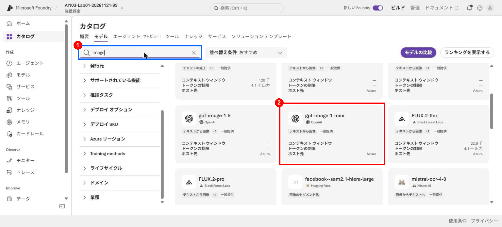
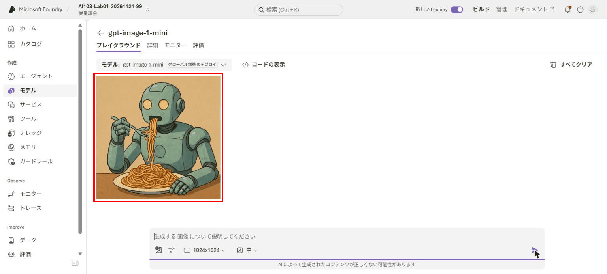

---
lab:
    title: 'AI による画像の生成'
    description: 'Microsoft Foundry の画像生成モデルを使用して画像を生成する。'
    level: 300
    duration: 35
    islab: true
    status: 'released'
---

# AI による画像の生成

この演習では、画像生成モデルを使用して画像を生成します。また、OpenAI Python SDK を使用して、プロンプトに基づいて画像を生成する簡単なアプリを作成します。

> **注意**: この演習はプレリリースの SDK ソフトウェアに基づいており、変更される可能性があります。必要な場合は特定のバージョンのパッケージを使用しているため、利用可能な最新バージョンを反映していないことがあります。予期しない動作、警告、またはエラーが発生する場合があります。

この演習の所要時間は約 **35** 分です。

## 前提条件

この演習を開始する前に、以下を準備してください。

* [演習 01](01-gen-ai-vision.md) の完了（Foundry プロジェクトを共用します）
* Visual Studio Code、Python 3.13 以降、Azure CLI（演習環境にはインストール済みです）

## 共用の Foundry プロジェクトを開く

この演習では、1 日目の演習 01 で作成した **East US 2** の Foundry プロジェクト（4 日目の演習 01 で開いたもの）を使用します。

1. Web ブラウザーで [Microsoft Foundry ポータル](https://ai.azure.com)（`https://ai.azure.com`）を開き、1 日目の演習 01 で作成したプロジェクト（例: **AI103-Lab01-YYYYMMDD-XX**）を開きます。ページ上部の **[新しい Foundry]**（New Foundry）トグルがオンになっていることを確認します。

1. プロジェクトのホーム ページで、**[API キー]**、**[プロジェクト エンドポイント]**、**[Azure OpenAI エンドポイント]** が表示されていることを確認します。

    > **ヒント**: このあとの手順で **Azure OpenAI エンドポイント** が必要になります。

## モデルのデプロイ

画像を生成できるモデルが必要です。

1. 左側のナビゲーション ペインで **[カタログ]**（Discover）を選択し、**[モデル]**（Models）タブを選択して、Microsoft Foundry のモデル カタログを表示します。

1. 検索ボックスに `image` と入力して検索し、一覧から `gpt-image-1-mini` を選択します。

    > **ヒント**: 検索ボックスに `gpt-image-1-mini` のような完全なモデル名を入力すると、結果が 0 件になることがあります。必ず `image` というキーワードで検索してください。

    

1. モデル カードで **[デプロイ]**（Deploy）> **[カスタム設定]**（Custom settings）を選択し、次のように設定して **[デプロイ]** を選択します。デプロイには 1 分ほどかかる場合があります。

    * **[デプロイ名]**: `gpt-image-1-mini`
    * **[デプロイの種類]**: **グローバル標準**（Global Standard）
    * **[1 分あたりの要求レート制限]**（Requests per minute rate limit）: **3**

    > **重要**: 演習環境ではクォータに上限があるため、**[既定の設定]** ではなく、必ず **[カスタム設定]** を選択し、**[1 分あたりの要求レート制限]** を **3** に設定してデプロイしてください（このモデルでは TPM ではなく、1 分あたりの要求数で制限を設定します）。既定値のままだと、クォータ不足でデプロイできないことがあります。

    ![gpt-image-1-mini のデプロイ パネルのスクリーンショット。赤枠は [デプロイ名]、[デプロイの種類]、[デプロイ] ボタン、青枠は [1 分あたりの要求レート制限]。](../Media/d4e02-02-deploy-gpt-image-1-mini.png)

    モデルがデプロイされると、そのモデルのプレイグラウンドが表示されます。

    > **ヒント**: 使用したモデルの **デプロイ名** を控えておいてください。あとで必要になります。

    > **注意**: モデルの提供状況やクォータは、リージョンによって異なります。

    > **注意**: 1 分あたりの要求レート制限を 3 に設定しているため、画像の生成を短時間に続けて何度も実行すると、レート制限（`429` エラー）が発生することがあります。その場合は、1 分ほど待ってから再度実行してください。

## プレイグラウンドでのモデルのテスト

クライアント アプリケーションを作成する前に、プレイグラウンドで `gpt-image-1-mini` モデルをテストします。

1. プレイグラウンドで、`gpt-image-1-mini` のデプロイが選択されていることを確認します。次に、ページの下部近くにあるボックスで、サイズに利用可能な最小のサイズ（**1024x1024**。既定値）を選択し、`A robot eating spaghetti` のようなプロンプトを入力して、入力欄の右端の送信ボタンを選択します。画像の生成には 20〜30 秒ほどかかります。

    ![画像プレイグラウンドのスクリーンショット。赤枠は [モデル] の gpt-image-1-mini、サイズ 1024x1024、送信ボタン、青枠はプロンプトの入力欄。](../Media/d4e02-03-image-playground-prompt.png)

1. プレイグラウンドで、生成された画像を確認します。

    

1. `Show the robot in a restaurant` のようなフォローアップのプロンプトを入力して、生成された画像を確認します。

1. 納得のいく画像になるまで、新しいプロンプトでテストを続けて画像を調整します。

## クライアント アプリケーションの作成

### スターター コードを開く

アプリケーションの初期ファイルは、演習環境に配置済みです。

1. Visual Studio Code を開きます。

1. **[ファイル] > [フォルダーを開く]** を選択し、配置済みの `Labfiles/02-generate-image` フォルダーを開きます。

1. VS Code のエクスプローラー ペインで **Python** フォルダーを展開し、フォルダー内のファイルを確認します。

    * `.env` - アプリケーション設定の構成ファイル
    * `image-client.py` - 画像アプリケーションの Python コード ファイル
    * `requirements.txt` - パッケージの依存関係を一覧にしたファイル

### アプリケーションの構成の準備

1. **Python** フォルダーを右クリックし、**[統合ターミナルで開く]** を選択します。ターミナルが **Python** フォルダーで開いていることを確認します。

1. ターミナルで次のコマンドを入力して、演習用にあらかじめ構築済みの仮想環境 (`labenv`) を有効化します。

    ```
    .\labenv\Scripts\Activate.ps1
    ```

    > **注意**: 必要な Python パッケージは `labenv` に事前インストール済みです。`pip install` を再実行する必要はありません。

1. **.env** ファイルを開き、構成値を更新します。Foundry リソースの **Azure OpenAI エンドポイント** と、画像生成モデルの **デプロイ名** を設定します。

    > **重要**: 必ず `https://{Foundry リソース名}.openai.azure.com/openai/v1/` の形式の Azure OpenAI エンドポイントを指定してください。プロジェクト エンドポイントでは <u>ありません</u>。

    変更後、**Ctrl+S** キーを押して構成ファイルを保存します。

### プロジェクトに接続してモデルとチャットするコードの記述

1. VS Code で `image-client.py` ファイルを開きます。

1. コード ファイルの先頭に、必要な SDK の名前空間をインポートする既存のステートメントがあります。次に、コメント **参照の追加** の下に、前にインストールしたライブラリの名前空間を参照する以下のコードを追加します。

    ```python
    # 参照の追加
    from dotenv import load_dotenv
    from azure.identity import DefaultAzureCredential, get_bearer_token_provider
    from openai import OpenAI
    import requests
    import base64
    ```

1. **main** 関数の、コメント **構成設定を取得** の下で、構成ファイルで定義したエンドポイントとモデルのデプロイ名の値をコードが読み込んでいます。

1. コメント **クライアントを初期化** の下に、現在サインインしている Azure の資格情報を使用してモデルに接続する以下のコードを追加します。

    ```python
    # クライアントを初期化
    token_provider = get_bearer_token_provider(
        DefaultAzureCredential(exclude_environment_credential=True,
            exclude_managed_identity_credential=True),
        "https://cognitiveservices.azure.com/.default"
    )

    client = OpenAI(
        base_url=endpoint,
        api_key=token_provider(),
    )
    ```

1. コードには、ユーザーが「quit」と入力するまでプロンプトを入力できるループが含まれています。ループ セクションで、コメント **画像を生成** の下に、プロンプトを送信して、生成された画像のデータをモデルから取得する以下のコードを追加します。

    ```python
    # 画像を生成
    img = client.images.generate(
        model=model_deployment,
        prompt=input_text,
        n=1
    )

    json_response = json.loads(img.model_dump_json())
    image_data = json_response["data"][0].get("b64_json")
    image_data_in_bytes = base64.b64decode(image_data)
    ```

    > **注意**: `gpt-image-1-mini` を含む gpt-image モデルは、生成した画像を `b64_json` の base64 エンコードされたデータとして返します。

1. **main** 関数の残りのコードは、画像データとファイル名を、用意されている関数に渡しています。この関数は、画像をデコードして .png ファイルとして保存します。

1. コード ファイルに加えた変更を保存します。

### クライアント アプリケーションの実行

1. ターミナル ペインで、次のコマンドを使用して Azure にサインインします。

    ```
    az login
    ```

1. メッセージに従って Azure にサインインします。

1. サインインしたら、次のコマンドを入力してアプリケーションを実行します。

    ```
    python image-client.py
    ```

1. プロンプトが表示されたら、`Create an image of a robot eating pizza` のように、画像の生成を依頼するプロンプトを入力します。

    しばらくすると、画像が保存されたことがアプリに表示されます。画像は、プロジェクト ディレクトリの `images` フォルダーに `image_1.png` という名前で保存されます。

    **出力例**:

    ```output
    プロンプトを入力してください ('quit' で終了): 画像を保存しました: C:\...\Labfiles\02-generate-image\Python\images\image_1.png
    ```

1. さらにいくつかのプロンプトを試します。終わったら、`quit` と入力してプログラムを終了します。

1. `images` フォルダーに生成された画像を確認します。

## クリーンアップ

この演習でデプロイした **画像生成モデルと Foundry プロジェクトは、まだ削除しないでください。** リソースの削除は、[演習 06](06-knowledge-mining.md) の「クリーンアップ」で、1〜4 日目の分をまとめて行います。
