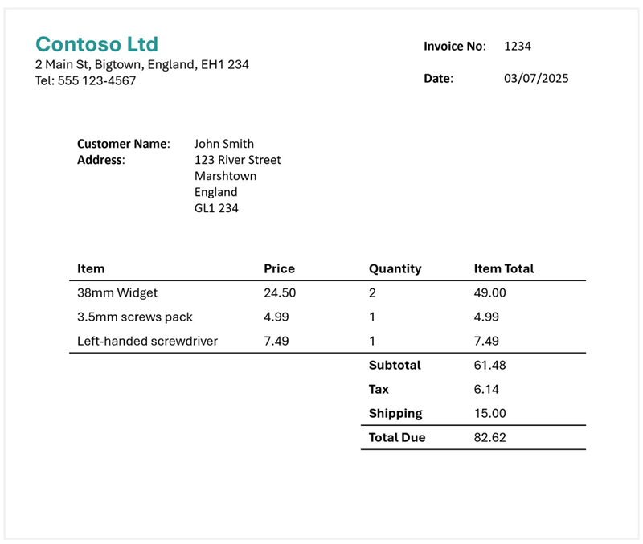
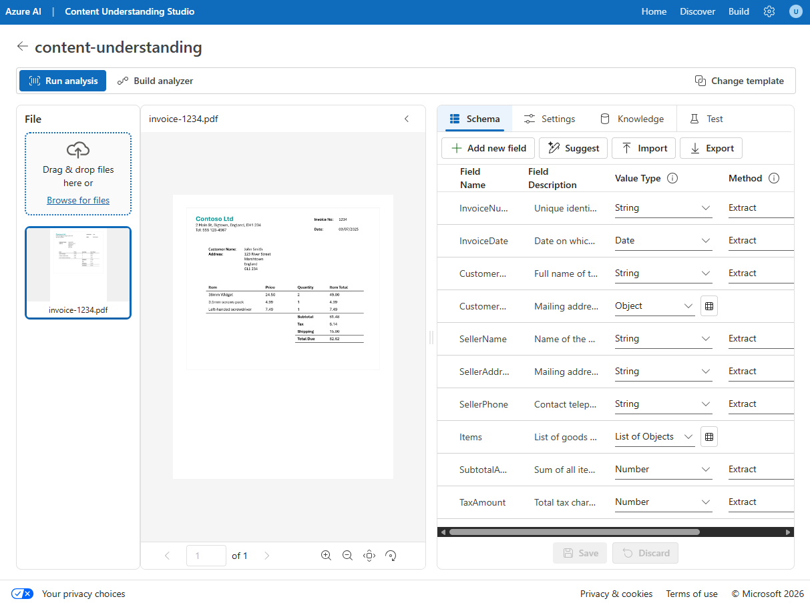
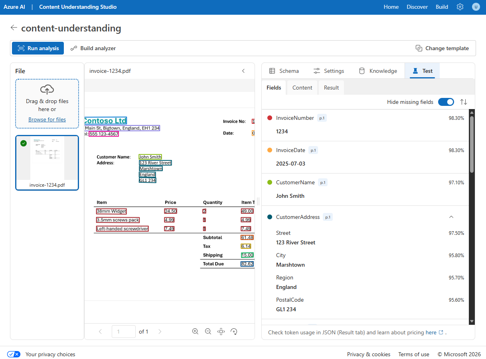
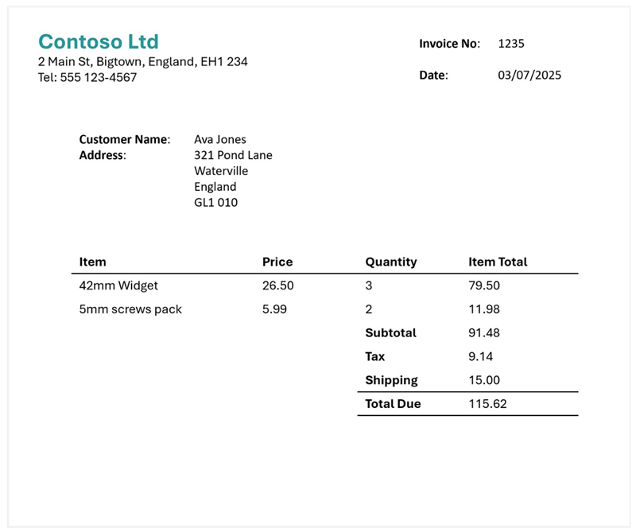
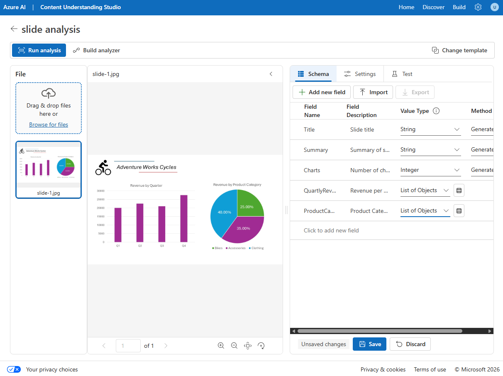
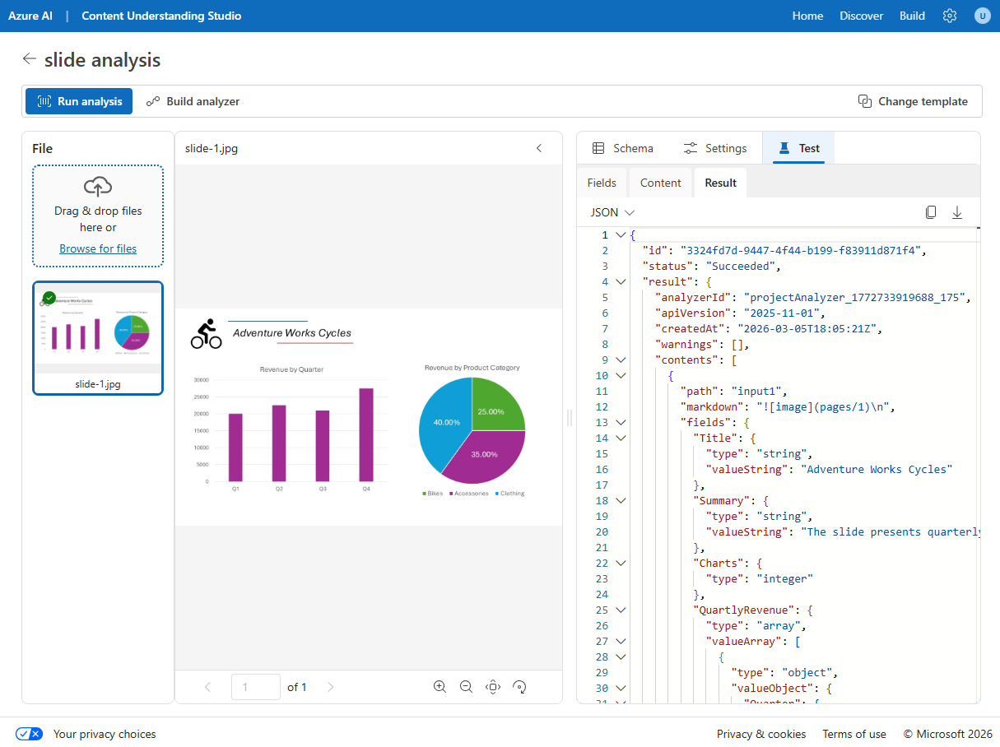

---
lab:
    title: 'マルチモーダル コンテンツからの情報の抽出'
    description: 'Azure Content Understanding を使用して、ドキュメント、画像、音声録音、ビデオから分析情報を抽出する。'
    duration: 40
    level: 200
    islab: true
    status: 'released'
---

# マルチモーダル コンテンツからの情報の抽出

この演習では、Azure Content Understanding を使用して、さまざまな種類のコンテンツから情報を抽出します。対象は、請求書、グラフを含むスライドの画像、ボイスメッセージの音声録音、電話会議のビデオ録画です。

この演習は、Foundry ポータルと Content Understanding Studio の操作が中心です（**Python のコードはありません**）。

この演習の所要時間は約 **40** 分です。

> **注意**: この演習で使用する一部のテクノロジーはプレビュー中または開発中のため、予期しない動作、警告、またはエラーが発生する場合があります。

## 前提条件

- [演習 01](01-gen-ai-vision.md) の完了（Foundry プロジェクトとモデルを共用します）
- [演習 03](03-content-understanding-image.md) の完了（ストレージ アカウントと Content Understanding Studio へのリソースの接続を再利用します）

## 共用の Foundry リソースとプロジェクトの確認

この演習で使用する機能には、Microsoft Foundry のリソースとプロジェクトが必要です。新しいプロジェクトは作成せず、1 日目の演習 01 で作成した **East US 2** のプロジェクト（4 日目の演習 01 で開いたもの）を使用します。

1. Web ブラウザーで [Microsoft Foundry ポータル](https://ai.azure.com)（`https://ai.azure.com`）を開き、Azure の資格情報でサインインします。初回サインイン時に表示されるヒントやクイック スタートのペインは閉じます。

1. **[New Foundry]** トグルをオンにして、**Foundry (new)** を使用していることを確認します。

1. 左上のプロジェクト名が、1 日目の演習 01 で作成したプロジェクト（例: **AI103-Lab01-YYYYMMDD-XX**）になっていることを確認します。

    > **注意**: Azure Content Understanding は、特定のリージョンで利用できます。最新の提供状況については、[リージョン サポートのドキュメント](https://learn.microsoft.com/azure/ai-services/content-understanding/language-region-support) を参照してください。

## コンテンツの確認

分析するコンテンツは、演習環境に配置済みです。

1. エクスプローラー ペインまたはファイル マネージャーで、`Labfiles/04-content-understanding-multimodal/content` フォルダーを開き、次のファイルがあることを確認します。この演習では、これらのファイルを使用して Content Understanding のアナライザーを調べます。

    | ファイル | 内容 |
    |--|--|
    | **invoice-1234.pdf**、**invoice-1235.pdf** | 請求書（PDF） |
    | **slide-1.jpg**、**slide-2.jpg** | グラフを含むスライドの画像 |
    | **call-1.mp3**、**call-2.mp3** | ボイスメッセージの音声録音（AI で生成された音声） |
    | **meeting-1.mp4**、**meeting-2.mp4** | 電話会議のビデオ録画（AI で生成された動画） |

> **注意**: 特定のモダリティ（ドキュメント、画像、ビデオ、音声）の分析だけに関心がある場合は、以下の該当するタスクに進んでかまいません。最良の体験を得るには、各タスクを順に進めて、さまざまな種類のコンテンツから情報を抽出する方法を学習してください。

## Microsoft Foundry の事前構築済みアナライザーを試す

Azure Content Understanding には、カスタム構成を必要とせずにドキュメントからテキストと構造要素を抽出できる、事前構築済みの **Read** アナライザーと **Layout** アナライザーが含まれています。これらの事前構築済みアナライザーは、Foundry (new) ポータルで AI Services のモデルとして直接利用できます。

### プレイグラウンドで Layout アナライザーを使用する

1. [Microsoft Foundry ポータル](https://ai.azure.com)で、**New Foundry** トグルがオンになっていることを確認します。

1. 右上のメニューで **[ビルド]**（Build）を選択し、左側のペインで **[サービス]**（Services）を選択します。Foundry Tools のサービスと、**[Featured playgrounds]** に事前構築済みの機能が表示されます。

1. **[Featured playgrounds]** の **Document Layout** を選択します。

    ![Foundry ポータルの [サービス] ページのスクリーンショット。赤枠は左側の [サービス] と [Featured playgrounds] の [Document Layout]。](../Media/d4e04-01-foundry-services-document-layout.png)

    **Document Intelligence and Content Understanding - レイアウト** のプレイグラウンド ページが開きます。このページでは、サンプル データまたは独自のファイルでレイアウト モデルをテストできます。

1. プレイグラウンドの左側の **[ファイルの参照]** を使用して、`Labfiles/04-content-understanding-multimodal/content` フォルダーの **invoice-1234.pdf** ファイルをアップロードします。このファイルには、次の請求書が含まれています。

    

1. **[Run]** を選択してアナライザーを実行し、分析が完了するまで待ちます。

1. 結果を確認します。抽出されたコンテンツは、**[Markdown]**、**[段落]**、**[テーブル]** などのタブの書式設定された出力、または **[結果]** タブの生の JSON データとして表示できます。Layout アナライザーが、ドキュメントからテキスト、表、段落やセクションなどの構造要素を抽出します。

    ![レイアウトのプレイグラウンドのスクリーンショット。赤枠は [ファイルの参照]、[Run] ボタン、結果のタブ。](../Media/d4e04-02-layout-playground-run.png)

    > **注意**: 事前構築済みの **OCR/Read** アナライザーと **Layout** アナライザーは、生成 AI モデルを必要とせずにドキュメントからコンテンツを抽出します。**OCR/Read** はテキスト要素（単語、段落、数式、バーコード）を抽出し、**Layout** はさらに表、図、ドキュメント構造、ハイパーリンク、注釈を抽出します。これらのアナライザーは汎用的なコンテンツ抽出に役立ちますが、請求書の金額やベンダー名などの特定のカスタム フィールドは抽出しません。

1. 必要に応じて、**[サービス]** ページに戻り、**[Featured playgrounds]** の **OCR Read** で同じファイルを試して、結果を比較します。Read はレイアウト分析なしでテキストを抽出します。

## カスタム アナライザー用の Content Understanding Studio のセットアップ

請求書の金額、発信者名、会議の参加者などの特定のフィールドをコンテンツから抽出するには、カスタム アナライザーを作成する必要があります。カスタム アナライザーは、**Content Understanding Studio** で作成します。Content Understanding Studio は、カスタム スキーマを使用してアナライザーを構築・テストするための、独立した Web ベースのツールです。

1. 新しいブラウザー タブで [Content Understanding Studio](https://contentunderstanding.ai.azure.com)（`https://contentunderstanding.ai.azure.com`）を開きます。

1. メッセージが表示されたら、Foundry ポータルで使用したのと同じ Azure の資格情報でサインインします。

1. **[設定]**（Settings）ページ（またはリソースのセットアップにリダイレクトされた場合）で、**[+ リソースの追加]**（+ Add resource）ボタンを選択します。

1. 先ほど確認した Foundry リソースを選択し、**[次へ]**（Next）> **[保存]**（Save）を選択します。

    > **ヒント**: **[既定のデプロイが利用できない場合、必要なモデルの自動デプロイを有効にする]**（Enable autodeployment for required models if no defaults are available）チェック ボックスがオンになっていることを確認します。これにより、カスタム アナライザーに必要なモデルがリソースにセットアップされます（検証時は、チャット完了モデルとして 1 日目にデプロイ済みの `gpt-5`・`gpt-5-mini` が構成され、埋め込みモデル `text-embedding-3-large` が自動でデプロイされました）。

    > **ヒント**: [演習 03](03-content-understanding-image.md) でこのリソースをすでに接続している場合は、この手順は不要です。**[接続済みの Azure AI Foundry リソース]** に自分のリソースが表示されていることを確認してください。

1. リソースが接続されたら、カスタム アナライザーを作成する準備ができました。上部のナビゲーションで **[Content Understanding]** を選択して、ホーム ページに移動します。

## 請求書ドキュメントからの情報の抽出

請求書から特定のフィールドを抽出できる、カスタムの Azure Content Understanding アナライザーを構築します。Content Understanding Studio でプロジェクトを作成し、サンプルの請求書に基づいてスキーマを定義して、再利用可能なアナライザーを構築します。

### ストレージ アカウントの確認

Content Understanding Studio には、カスタム アナライザーの構築に使用するデータを保存するための Azure Blob Storage アカウントが必要です。[演習 03](03-content-understanding-image.md) で、Foundry リソースと同じリソース グループ（**AI103StudentXX**）にストレージ アカウントを作成済みです。**そのストレージ アカウントを再利用するため、新しく作成する必要はありません。**

> **注意**: 演習 03 を実施していない場合は、演習 03 の「Azure ストレージ アカウントの作成」の手順で、Foundry リソースと同じリソース グループ・同じリージョンにストレージ アカウントを作成してください。他の演習で、同じリソース グループ・同じリージョン（East US 2）に作成済みのストレージ アカウントがある場合は、それを再利用することもできます。

### 請求書分析のスキーマの定義

1. Content Understanding Studio で、メニュー バーの **[Build]**（構築）を選択し、**[Create]**（作成）を選択します。

1. **[Extract content and field with custom schema]**（カスタム スキーマでコンテンツとフィールドを抽出する）を選択し、次の設定でプロジェクトを作成します。
    - **プロジェクト名**: `Invoice analysis`
    - **説明**: `Extract data from an invoice`
    - **詳細設定**（Advanced settings。展開して設定します）
        - **ストレージ アカウントの接続**（Connect storage account）: *演習 03 で使用したストレージ アカウント（`ai103stgXXYYYYMMDD`）を選択します*
        - **BLOB コンテナー**（Blob container）: *演習 03 で作成した `content-understanding` を選択します（演習 03 を実施していない場合は、[Create a new container] で `content-understanding` を作成します）*
        - **チャット完了モデル**（Chat completion model）: **gpt-5-mini**（既定の gpt-5 から変更します）

    ![[Advanced settings] のスクリーンショット。赤枠は [Storage account]、[Blob container] の content-understanding、[Chat completion model]（画面は既定の gpt-5。gpt-5-mini に変更します）。](../Media/d4e04-03-cu-invoice-project-storage.png)

1. プロジェクトが作成されるまで待ちます。

    > **ヒント**: ストレージへのアクセスでエラーが発生した場合は、1 分待ってからもう一度試してください。新しいリソースのアクセス許可が反映されるまでに数分かかることがあります。

1. `Labfiles/04-content-understanding-multimodal/content` フォルダーの **invoice-1234.pdf** ファイルをアップロードします。

    Content Understanding が、データを分類して、アップロードしたコンテンツに基づいてアナライザーのテンプレートを推奨します。

1. **[テンプレートの選択]**（Choose a template）ウィンドウで **Invoice** テンプレートを選択し、**[保存]**（Save）を選択します。

    ![[Choose a template] ダイアログのスクリーンショット。赤枠は [Invoice] と [Save] ボタン。](../Media/d4e04-04-cu-invoice-template.png)

    *Invoice* テンプレートには、請求書でよく見られるフィールドが含まれています。スキーマ エディターを使用して、不要な推奨フィールドを削除したり、必要なカスタム フィールドを追加したりできます。

1. 推奨フィールドの一覧で **BillingAddress** を選択します。このフィールドは、アップロードした請求書の形式では不要なため、選択した行の末尾に表示される **フィールドの削除**（**&#128465;**）アイコンを使用して削除します。

1. スキーマ タブの上部のバーで **[提案]**（Suggest）を選択します。サンプルの請求書を調べて、スキーマに含めるべきフィールドが提案されます。**Items** フィールドを展開して、提案されているサブフィールドを確認します。これらのフィールドを追加すると既存のスキーマが置き換えられるため、スキーマを編集している場合はプロジェクトで注意してください。**[保存]** を選択します。

1. **[+ 新しいフィールドを追加]**（+ Add new field）ボタンを使用して、次のフィールドを追加します。新しいフィールドごとに **保存**（**&#10003;**）を選択します。

    | フィールド名 | フィールドの説明 | 値の型 | メソッド |
    |--|--|--|--|
    | `TotalQuantity` | `Total number of items on the invoice` | 文字列（String） | 自動（Auto） |

1. 完成したスキーマが次のようになっていることを確認し、**[保存]** を選択します。

    

1. **[テスト]**（Test）タブを選択し、**[分析の実行]**（Run analysis）を選択してスキーマをテストします。分析が完了するまで待ちます。

    ![[Run analysis] の結果のスクリーンショット。赤枠は [Run analysis] ボタンと、抽出されたフィールドと信頼度。画面は Invoice テンプレートの既定のスキーマで実行した例。](../Media/d4e04-05-cu-invoice-run-analysis.png)

1. 分析結果を確認します。次のようになっているはずです。

    

1. **[フィールド]**（Fields）ペインで、識別されたフィールドの詳細を表示します。

### 請求書用アナライザーの構築とテスト

請求書からフィールドを抽出するスキーマを定義したので、同様のドキュメントで使用するアナライザーを構築できます。

1. 上部の **[アナライザーのビルド]**（Build analyzer）ボタンを選択し、次のプロパティで新しいアナライザーを構築します（ここに示すとおりに入力します）。
    - **名前**: `invoiceanalyzer`
    - **説明**: `Invoice analyzer`

1. アナライザーがビルドされたら、**[アナライザー一覧へ移動]**（Jump to analyzer list）を選択してビルド済みのすべてのアナライザーを表示し、**invoiceanalyzer** のリンクを選択します。アナライザーのスキーマで定義したフィールドが表示されます。

1. **invoiceanalyzer** ページで、**[テスト]** タブを選択します。

1. `content` フォルダーの **invoice-1235.pdf** をアップロードし、分析を実行して、請求書からフィールド データを抽出します。

    分析する請求書は次のようなものです。

    

1. **[フィールド]** ペインを確認し、アナライザーがテスト用の請求書から正しいフィールドを抽出したことを確認します。

1. **[結果]**（Results）ペインを確認して、アナライザーがクライアント アプリケーションに返す JSON 応答を確認します。

1. **invoiceanalyzer** ページを閉じて、アナライザーの一覧に戻ります。

## スライド画像からの情報の抽出

グラフを含むスライドから情報を抽出できる、カスタムの Azure Content Understanding アナライザーを構築します。

### 画像分析のスキーマの定義

1. **[プロジェクト一覧]**（Project list）タブで **[作成]** を選択し、**[カスタム スキーマでコンテンツとフィールドを抽出する]** を選択して、次の設定でプロジェクトを作成します。
    - **プロジェクト名**: `Slide analysis`
    - **説明**: `Extract data from an image of a slide`
    - **詳細設定**: *前のプロジェクトと同じ設定であることを確認します*

1. プロジェクトが作成されるまで待ちます。

1. `content` フォルダーの **slide-1.jpg** ファイルをアップロードします。次に、**[画像分析]**（Image analysis）テンプレートを選択し、**[保存]** を選択します。

    *画像分析* テンプレートには、事前定義されたフィールドは含まれていません。抽出したい情報を説明するフィールドを定義する必要があります。

1. **[+ 新しいフィールドを追加]** ボタンを使用して、次のフィールドを追加します。新しいフィールドごとに **変更を保存**（**&#10003;**）を選択します。

    | フィールド名 | フィールドの説明 | 値の型 | メソッド |
    |--|--|--|--|
    | `Title` | `Slide title` | 文字列（String） | 生成（Generate） |
    | `Summary` | `Summary of the slide` | 文字列（String） | 生成（Generate） |
    | `Charts` | `Number of charts on the slide` | 整数（Integer） | 生成（Generate） |

1. **[+ 新しいフィールドを追加]** ボタンを使用して、`QuarterlyRevenue` という名前で、説明が `Revenue per quarter`、値の型が **オブジェクトのリスト**（List of objects）の新しいフィールドを追加します。次に、値の型のドロップダウンの横にあるテーブル アイコンを選択します。開いたテーブルのサブフィールド用の新しいページで、次のサブフィールドを追加します。

    | フィールド名 | フィールドの説明 | 値の型 | メソッド |
    |--|--|--|--|
    | `Quarter` | `Which quarter?` | 文字列（String） | 生成（Generate） |
    | `Revenue` | `Revenue for the quarter` | 数値（Number） | 生成（Generate） |

1. **[戻る]**（Back）を選択してスキーマの最上位レベルに戻り、**[+ 新しいフィールドを追加]** ボタンを使用して、`ProductCategories` という名前で、説明が `Product categories`、値の型が **オブジェクトのリスト** の新しいフィールドを追加します。次に、値の型の横にあるテーブル アイコンを選択して、テーブルのサブフィールド用の新しいページを開き、次のサブフィールドを追加します。

    | フィールド名 | フィールドの説明 | 値の型 | メソッド |
    |--|--|--|--|
    | `ProductCategory` | `Product category name` | 文字列（String） | 生成（Generate） |
    | `RevenuePercentage` | `Percentage of revenue` | 数値（Number） | 生成（Generate） |

1. **[戻る]** を選択してスキーマの最上位レベルに戻り、次のようになっていることを確認します。次に、**[保存]** を選択します。

    

1. **[テスト]** タブを選択し、**[分析の実行]** を選択して、分析が完了するまで待ちます。

1. 分析結果を確認します。次のようになっているはずです。

    

1. **[フィールド]** ペインで、識別されたフィールドの詳細を表示します。**QuarterlyRevenue** と **ProductCategories** フィールドを展開して、サブフィールドの値を確認します。

### アナライザーの構築とテスト

スライドからフィールドを抽出するスキーマを定義したので、同様のスライド画像で使用するアナライザーを構築できます。

1. 上部の **[アナライザーのビルド]** ボタンを選択し、次のプロパティで新しいアナライザーを構築します（ここに示すとおりに入力します）。
    - **名前**: `slideanalyzer`
    - **説明**: `Slide image analyzer`

1. アナライザーがビルドされたら、**[アナライザー一覧へ移動]** を選択し、**slideanalyzer** のリンクを選択します。アナライザーのスキーマで定義したフィールドが表示されます。

1. **slideanalyzer** ページで、**[テスト]** タブを選択します。

1. **[+ テスト ファイルのアップロード]**（+ Upload test files）ボタンを使用して、`content` フォルダーの **slide-2.jpg** をアップロードし、分析を実行して、画像からフィールド データを抽出します。

1. **[フィールド]** ペインを確認し、アナライザーがスライド画像から正しいフィールドを抽出したことを確認します。

    > **注意**: スライド 2 には製品カテゴリ別の内訳が含まれていないため、製品カテゴリ別の売上データは見つかりません。

1. **[結果]** ペインを確認して、アナライザーがクライアント アプリケーションに返す JSON 応答を確認します。

1. **slideanalyzer** ページを閉じます。

## ボイスメール音声録音からの情報の抽出

ボイスメッセージの音声録音から情報を抽出できる、カスタムの Azure Content Understanding アナライザーを構築します。

### 音声分析のスキーマの定義

1. **[プロジェクト一覧]** タブで **[作成]** を選択し、**[カスタム スキーマでコンテンツとフィールドを抽出する]** を選択して、次の設定でプロジェクトを作成します。
    - **プロジェクト名**: `Voicemail analysis`
    - **説明**: `Extract data from a voicemail recording`
    - **詳細設定**: *前のプロジェクトと同じ設定であることを確認します*

1. プロジェクトが作成されるまで待ちます。

1. `content` フォルダーの **call-1.mp3** ファイルをアップロードします。次に、**[音声分析]**（Audio analysis）テンプレートを選択し、**[保存]** を選択します。

1. **[+ 新しいフィールドを追加]** ボタンを使用して、次のフィールドを追加します。新しいフィールドごとに **保存**（**&#10003;**）を選択します。

    | フィールド名 | フィールドの説明 | 値の型 | メソッド |
    |--|--|--|--|
    | `Caller` | `Person who left the message` | 文字列（String） | 生成（Generate） |
    | `Summary` | `Summary of the message` | 文字列（String） | 生成（Generate） |
    | `Actions` | `Requested actions` | 文字列（String） | 生成（Generate） |
    | `CallbackNumber` | `Telephone number to return the call` | 文字列（String） | 生成（Generate） |
    | `AlternativeContacts` | `Alternative contact details` | 文字列のリスト（List of Strings） | 生成（Generate） |

1. **[分析の実行]** を選択し、分析が完了するまで待ちます。

    音声の分析には時間がかかることがあります。待っている間に、`content` フォルダーの **call-1.mp3** をローカルで再生して、音声を聞くことができます。
1. 分析結果を確認し、**[フィールド]** ペインで識別されたフィールドの詳細を表示します。**AlternativeContacts** フィールドを展開して、一覧表示された値を確認します。

### アナライザーの構築とテスト

音声メッセージからフィールドを抽出するスキーマを定義したので、同様の音声録音で使用するアナライザーを構築できます。

1. 上部の **[アナライザーのビルド]** ボタンを選択し、次のプロパティで新しいアナライザーを構築します（ここに示すとおりに入力します）。
    - **名前**: `voicemailanalyzer`
    - **説明**: `Voicemail audio analyzer`

1. アナライザーがビルドされたら、**[アナライザー一覧へ移動]** を選択し、**voicemailanalyzer** のリンクを選択します。アナライザーのスキーマで定義したフィールドが表示されます。

1. **voicemailanalyzer** ページで、**[テスト]** タブを選択します。

1. **[+ テスト ファイルのアップロード]** ボタンを使用して、`content` フォルダーの **call-2.mp3** をアップロードし、分析を実行して、音声ファイルからフィールド データを抽出します。

    音声の分析には時間がかかることがあります。待っている間に、**call-2.mp3** をローカルで再生して、音声を聞くことができます。
1. **[フィールド]** ペインを確認し、アナライザーが音声メッセージから正しいフィールドを抽出したことを確認します。

1. **[結果]** ペインを確認して、アナライザーがクライアント アプリケーションに返す JSON 応答を確認します。

1. **voicemailanalyzer** ページを閉じます。

## ビデオ会議録画からの情報の抽出

電話会議のビデオ録画から情報を抽出できる、カスタムの Azure Content Understanding アナライザーを構築します。

### ビデオ分析のスキーマの定義

1. Content Understanding Studio で、ホーム ページの **[プロジェクトの作成]**（Create project）を選択します（または、まずナビゲーションを使用してホーム ページに戻ります）。

1. **[カスタム スキーマでコンテンツとフィールドを抽出する]** を選択し、次の設定でプロジェクトを作成します。
    - **プロジェクト名**: `Conference call video analysis`
    - **説明**: `Extract data from a video conference recording`

1. プロジェクトが作成されるまで待ちます。

1. `content` フォルダーの **meeting-1.mp4** ファイルをアップロードします。次に、**[ビデオ分析]**（Video analysis）テンプレートを選択し、**[作成]**（Create）を選択します。

1. 右側の **[コンテンツ]** ペインで、**[文字起こしのプレビューを取得]** を選択して、録画された会議の文字起こしを確認します。

    *ビデオ分析* テンプレートは、セグメントごとにデータを抽出します。事前定義されたフィールドは含まれていません。抽出したい情報を説明するフィールドを定義する必要があります。

1. **[+ 新しいフィールドを追加]** ボタンを使用して、次のフィールドを追加します。新しいフィールドごとに **保存**（**&#10003;**）を選択します。

    | フィールド名 | フィールドの説明 | 値の型 | メソッド |
    |--|--|--|--|
    | `Summary` | `Summary of the discussion` | 文字列（String） | 生成（Generate） |
    | `Participants` | `Count of meeting participants` | 整数（Integer） | 生成（Generate） |
    | `ParticipantNames` | `Names of meeting participants` | 文字列のリスト（List of Strings） | 生成（Generate） |
    | `SharedSlides` | `Descriptions of any PowerPoint slides presented` | 文字列のリスト（List of Strings） | 生成（Generate） |
    | `AssignedActions` | `Tasks assigned to participants` | オブジェクトのリスト（List of Objects） | 生成（Generate） |

1. **AssignedActions** フィールドを入力するときに、サブフィールドのテーブルに次のサブフィールドを作成します。

    | フィールド名 | フィールドの説明 | 値の型 | メソッド |
    |--|--|--|--|
    | `Task` | `Description of the task` | 文字列（String） | 生成（Generate） |
    | `AssignedTo` | `Who the task is assigned to` | 文字列（String） | 生成（Generate） |

1. **[戻る]** を選択してスキーマの最上位レベルに戻り、スキーマが上の表のとおりになっていることを確認します。次に、**[保存]** を選択します。

1. **[分析の実行]** を選択し、分析が完了するまで待ちます。

    ビデオの分析には時間がかかることがあります。待っている間に、`content` フォルダーの **meeting-1.mp4** をローカルで再生して、ビデオを見ることができます。
1. 分析が完了したら、結果を確認します。

1. **[フィールド]** ペインで、抽出されたデータを表示します。

### アナライザーの構築とテスト

会議録画からフィールドを抽出するスキーマを定義したので、同様のビデオで使用するアナライザーを構築できます。

1. 上部の **[アナライザーのビルド]** ボタンを選択し、次のプロパティで新しいアナライザーを構築します（ここに示すとおりに入力します）。
    - **名前**: `meetinganalyzer`
    - **説明**: `Meeting video analyzer`

1. 新しいアナライザーの準備ができるまで待ちます（**[更新]**（Refresh）ボタンを使用して確認します）。

1. アナライザーがビルドされたら、**[アナライザー一覧へ移動]** を選択し、**meetinganalyzer** のリンクを選択します。アナライザーのスキーマで定義したフィールドが表示されます。

1. **meetinganalyzer** ページで、**[テスト]** タブを選択します。

1. **[+ テスト ファイルのアップロード]** ボタンを使用して、`content` フォルダーの **meeting-2.mp4** をアップロードし、分析を実行して、ビデオ ファイルからフィールド データを抽出します。

    ビデオの分析には時間がかかることがあります。待っている間に、**meeting-2.mp4** をローカルで再生して、ビデオを見ることができます。
1. **[フィールド]** ペインを確認し、アナライザーが電話会議のビデオのショットごとに抽出したフィールドを確認します。

1. **[結果]** ペインを確認して、アナライザーがクライアント アプリケーションに返す JSON 応答を確認します。

1. **meetinganalyzer** ページを閉じます。

## クリーンアップ

この演習で作成した **アナライザー、Content Understanding のプロジェクト、ストレージ アカウント、Foundry プロジェクトは、まだ削除しないでください。**（演習 05 で Content Understanding への接続を再利用します。）リソースの削除は、[演習 06](06-knowledge-mining.md) の「クリーンアップ」で、1〜4 日目の分をまとめて行います。
