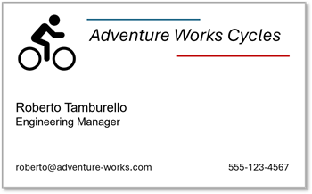
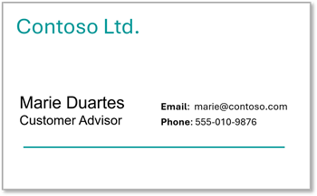

---
lab:
    title: 'Content Understanding クライアント アプリケーションの開発'
    description: 'Azure Content Understanding Python SDK を使用して、アナライザーをプログラムで作成して使用する。'
    duration: 45
    level: 300
    islab: true
    status: 'released'
---

# Content Understanding クライアント アプリケーションの開発

この演習では、Azure Content Understanding Python SDK を使用して、名刺から情報を抽出するアナライザーを作成します。次に、このアナライザーを使用して、スキャンした名刺から連絡先の詳細を抽出するクライアント アプリケーションを開発します。

この演習の所要時間は約 **45** 分です。

> **注意**: この演習で使用する一部のテクノロジーはプレビュー中または開発中のため、予期しない動作、警告、またはエラーが発生する場合があります。

## 前提条件

この演習を開始する前に、以下を準備してください。

- [演習 01](01-gen-ai-vision.md) の完了（Foundry プロジェクトと、1 日目の演習 01 でデプロイした **gpt-5-mini** モデルを共用します）
- [演習 03](03-content-understanding-image.md) の完了（Content Understanding Studio へのリソースの接続とモデルの自動デプロイを再利用します）
- Visual Studio Code、Python 3.13 以降、Azure CLI（演習環境にはインストール済みです）

## 共用の Foundry リソースとプロジェクトの確認

この演習で使用する機能には、Microsoft Foundry のリソースとプロジェクトが必要です。新しいプロジェクトは作成せず、1 日目の演習 01 で作成した **East US 2** のプロジェクト（4 日目の演習 01 で開いたもの）を使用します。

> **注意**: Azure Content Understanding は、特定のリージョンで利用できます。最新の提供状況については、[リージョン サポートのドキュメント](https://learn.microsoft.com/azure/ai-services/content-understanding/language-region-support) を参照してください。

1. Web ブラウザーで [Microsoft Foundry ポータル](https://ai.azure.com)（`https://ai.azure.com`）を開き、Azure の資格情報でサインインします。初回サインイン時に表示されるヒントやクイック スタートのペインは閉じます。

1. ページ上部の **[新しい Foundry]**（New Foundry）トグルをオンにして、新しい Foundry ポータルを使用していることを確認します。

1. 左上のプロジェクト名が、1 日目の演習 01 で作成したプロジェクト（例: **AI103-Lab01-YYYYMMDD-XX**）になっていることを確認します。

1. プロジェクト名を選択して、**[プロジェクトの詳細]**（Project details）を選択します。そのページで、親リソースへのリンクをたどります。このブラウザー タブは開いたままにしておきます。

## Content Understanding のモデルと接続の構成

Content Understanding は、プロジェクトにデプロイされた OpenAI モデルを分析に使用します。アナライザーを使用する前に、これらのモデルをデプロイし、Content Understanding と Foundry リソース間の接続を設定する必要があります。最も簡単な方法は、Content Understanding Studio を使用することです。

> **ヒント**: [演習 03](03-content-understanding-image.md) で、すでにこの接続とモデルの自動デプロイを済ませている場合は、**[接続済みの Azure AI Foundry リソース]** に自分のリソースが表示されていることを確認して、この手順を省略できます。

1. 新しいタブで [Content Understanding Studio](https://contentunderstanding.ai.azure.com/home)（`https://contentunderstanding.ai.azure.com/home`）に移動し、資格情報でサインインします。

1. 上部のナビゲーション バーにある設定の歯車アイコンを選択し、**[+ リソースの追加]**（+ Add resource）を選択します。

1. Foundry リソースを作成したサブスクリプションとリソース グループを選択し、ドロップダウンから Foundry リソース名を選択します。このリソースは、先ほど作成したプロジェクトの親リソースです。

1. **[自動デプロイを有効にする]**（Enable auto-deployment）ボックスがオンになっていることを確認し、**[次へ]**（Next）と **[保存]**（Save）を選択して構成を作成します。

1. Content Understanding に必要なモデルがデプロイされるまで待ちます。

## 開発環境の準備

アプリケーションの初期ファイルは、演習環境に配置済みです。

1. **Visual Studio Code** を起動します。

1. **[ファイル] > [フォルダーを開く]** を選択し、配置済みの `Labfiles/05-content-understanding-api` フォルダーを開きます。

1. VS Code のエクスプローラー ペインで **Python** フォルダーを展開します。フォルダーには、スキャンした名刺の画像が 2 つと、アプリを構築するために必要な Python コード ファイルが含まれています。

1. **Python** フォルダーを右クリックし、**[統合ターミナルで開く]** を選択します。ターミナルが **Python** フォルダーで開いていることを確認します。

1. ターミナルで次のコマンドを入力して、演習用にあらかじめ構築済みの仮想環境 (`labenv`) を有効化します。

    ```
    .\labenv\Scripts\Activate.ps1
    ```

    > **注意**: 必要な Python パッケージ (`azure-ai-contentunderstanding` を含む) は `labenv` に事前インストール済みです。`pip install` を再実行する必要はありません。

1. VS Code のエクスプローラー ペインで、**Python** フォルダーの **.env** ファイルを開きます。

1. ファイルの **your_endpoint** と **your_key** のプレースホルダーを、Microsoft Foundry リソースのエンドポイントと API キー（開いたままにしておいたポータルのタブからコピーしたもの）に置き換え、**ANALYZER_NAME** が `businesscardanalyzer` になっていることを確認します。

    > **ヒント**: エンドポイントとキーは、[Azure ポータル](https://portal.azure.com) で Microsoft Foundry リソースに移動し、**[リソース管理]** > **[キーとエンドポイント]**（Keys and Endpoint）を表示して確認することもできます。

    > **注意**: API キーは秘密情報です。**.env** 以外のファイルに貼り付けたり、他の人と共有したりしないでください。

1. ファイルを保存します（**Ctrl+S**）。

## Python SDK を使用したアナライザーの作成

Content Understanding の Python SDK を使用して、名刺の画像から情報を抽出できるアナライザーを作成します。

1. VS Code のエクスプローラー ペインで、**biz-card.json** ファイルを開いて、内容を確認します。この JSON は、名刺のアナライザー スキーマを定義しており、抽出するフィールド（Company、Name、Title、Email、Phone）を指定しています。

1. VS Code で **create-analyzer.py** ファイルを開きます。

1. コードを確認します。このコードは、次のことを行います。
    - [Azure Content Understanding SDK](https://learn.microsoft.com/python/api/overview/azure/ai-contentunderstanding-readme?view=azure-python-preview) の `ContentUnderstandingClient` と `AzureKeyCredential` をインポートする。
    - **biz-card.json** ファイルからアナライザーのスキーマを読み込む。
    - 環境構成ファイルから、エンドポイント、キー、アナライザー名を取得する。
    - **create_analyzer** という名前の関数を呼び出す（この関数は現在実装されていません）。

1. **create_analyzer** 関数で、コメント **Content Understanding アナライザーを作成** を見つけて、以下のコードを追加します。

    > **ヒント**: 関数の先頭にある `pass  # コードを追加したら、この行は削除してかまいません` の行は、関数が空にならないようにするための仮の行です。以下のコードを追加したら、この行は削除してかまいません。

    ```python
    # Content Understanding アナライザーを作成
    print(f"{analyzer} を作成しています")

    # Content Understanding クライアントを作成
    client = ContentUnderstandingClient(
        endpoint=endpoint,
        credential=AzureKeyCredential(key)
    )

    # スキーマ JSON を ContentAnalyzer オブジェクトに解析
    analyzer_definition = json.loads(schema)

    # SDK を使用してアナライザーを作成 (長時間実行操作)
    poller = client.begin_create_analyzer(
        analyzer_id=analyzer,
        resource=analyzer_definition,
        allow_replace=True
    )

    # 操作の完了を待機
    result = poller.result()
    print(f"アナライザー '{analyzer}' を作成しました。")
    print(f"ステータス: {result['status'] if isinstance(result, dict) else 'Succeeded'}")
    ```

    > **注意**: SDK は `LROPoller` パターンによってポーリングを自動的に処理するため、手動でポーリングする必要はありません。

1. ファイルを保存します（**Ctrl+S**）。

1. VS Code のターミナルで（仮想環境がまだ有効で、**Python** フォルダーにいることを確認して）、Python コードを実行します。

    ```
    python create-analyzer.py
    ```

1. プログラムの出力を確認します。アナライザーが作成されたことが示されているはずです。

    **出力例**:

    ```output
    businesscardanalyzer を作成しています
    アナライザー 'businesscardanalyzer' を作成しました。
    ステータス: Succeeded
    ```

## Python SDK を使用したコンテンツの分析

1. VS Code で **read-card.py** ファイルを開きます。

1. コードを確認します。このコードは、次のことを行います。
    - SDK の `ContentUnderstandingClient` と `AzureKeyCredential` をインポートする。
    - 分析する画像ファイルを識別する（既定は **biz-card-1.png**）。
    - 環境構成ファイルから、エンドポイントとキーを取得する。
    - **analyze_card** という名前の関数を呼び出す（この関数は現在実装されていません）。

1. **analyze_card** 関数で、コメント **Content Understanding を使用して画像を分析** を見つけて、以下のコードを追加します。

    > **ヒント**: 関数の先頭にある `pass  # コードを追加したら、この行は削除してかまいません` の行は、関数が空にならないようにするための仮の行です。以下のコードを追加したら、この行は削除してかまいません。

    ```python
    # Content Understanding を使用して画像を分析
    print(f"{image_file} を分析しています")

    # Content Understanding クライアントを作成
    client = ContentUnderstandingClient(
        endpoint=endpoint,
        credential=AzureKeyCredential(key)
    )

    # 画像データを読み取り
    with open(image_file, "rb") as file:
        image_data = file.read()

    # 分析のために画像を送信
    print("要求を送信しています...")
    poller = client.begin_analyze_binary(
        analyzer_id=analyzer,
        binary_input=image_data
    )

    # 分析の完了を待機
    result = poller.result()
    print("分析に成功しました:\n")

    # JSON の結果をファイルに保存
    output_file = "results.json"
    with open(output_file, "w") as json_file:
        json.dump(dict(result), json_file, indent=4, default=str)
        print(f"応答を {output_file} に保存しました\n")

    # コンテンツを順に処理してフィールドを抽出
    for content in result.contents:
        if hasattr(content, 'fields') and content.fields:
            for field_name, field_data in content.fields.items():
                value = field_data.value if hasattr(field_data, 'value') else None
                print(f"{field_name}: {value}")
    ```

1. ファイルを保存します（**Ctrl+S**）。

1. VS Code のターミナルで、Python コードを実行します。

    ```
    python read-card.py biz-card-1.png
    ```

1. プログラムの出力を確認します。次の名刺のフィールド値が表示されるはずです。

    

    **出力例**:

    ```output
    biz-card-1.png を分析しています
    要求を送信しています...
    分析に成功しました:

    応答を results.json に保存しました

    Company: Adventure Works Cycles
    Name: Roberto Tamburello
    Title: Engineering Manager
    Email: roberto@adventure-works.com
    Phone: 555-123-4567
    ```

1. 別の名刺を使用して、プログラムをもう一度実行します。

    ```
    python read-card.py biz-card-2.png
    ```

1. 結果を確認します。次の名刺の値が反映されているはずです（例: `Company: Contoso Ltd.`、`Name: Marie Duartes`、`Title: Customer Advisor`）。

    

1. 返された完全な JSON 応答を表示するには、VS Code で **results.json** ファイルを開くか、ターミナルで次のコマンドを実行します。

    ```
    cat results.json
    ```

## クリーンアップ

この演習で作成した **名刺アナライザー（businesscardanalyzer）、ストレージ アカウント、Foundry プロジェクトは、まだ削除しないでください。** リソースの削除は、[演習 06](06-knowledge-mining.md) の「クリーンアップ」で、1〜4 日目の分をまとめて行います。API キーを書き留めたファイルがある場合は、そのときに削除してください。
